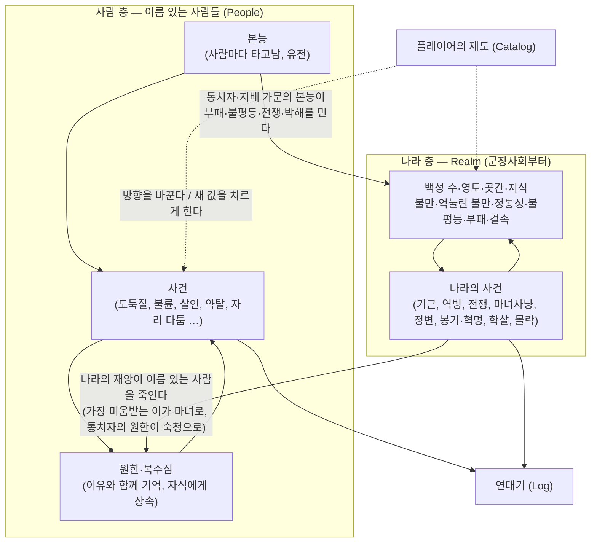
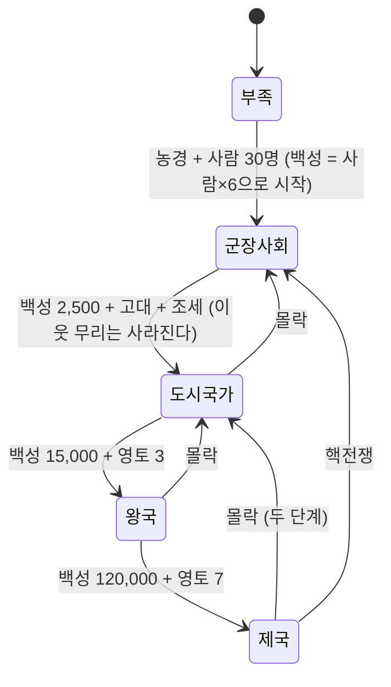
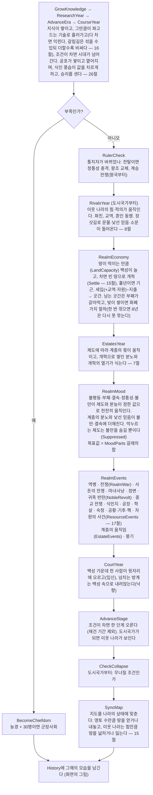
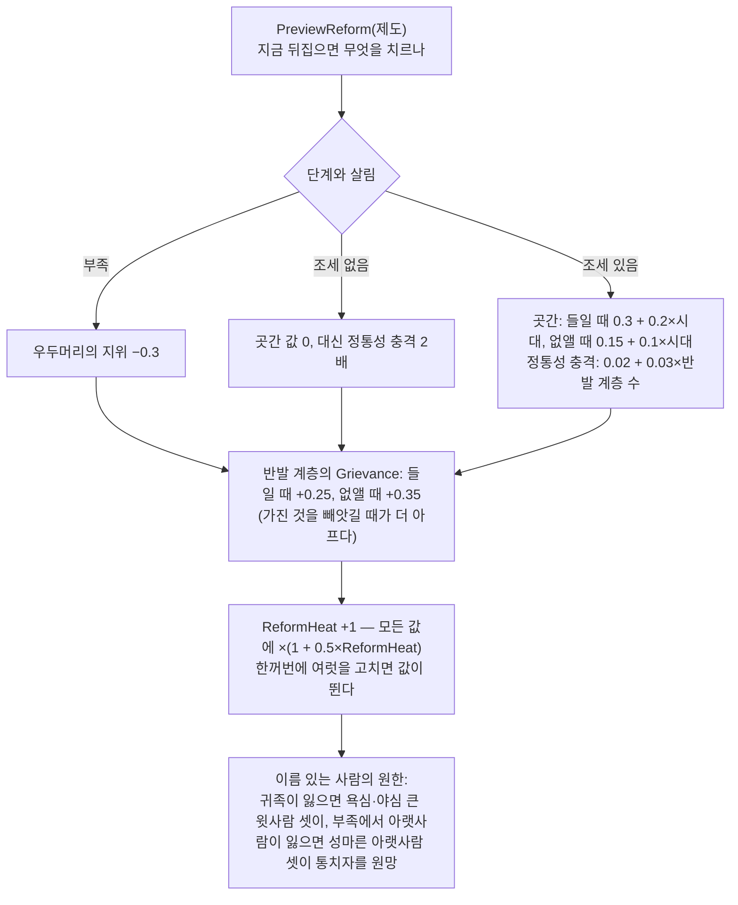
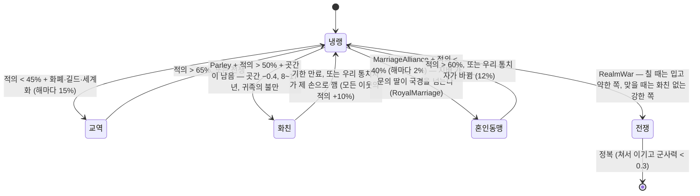
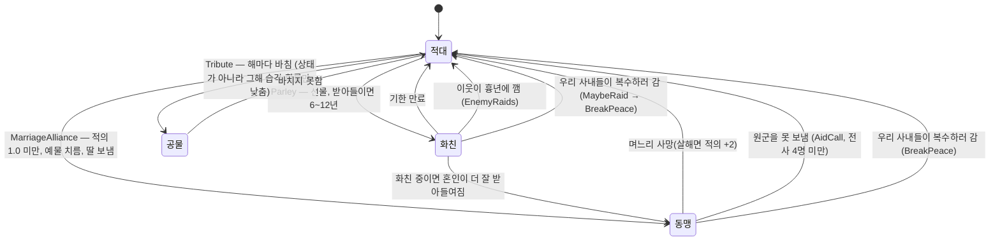
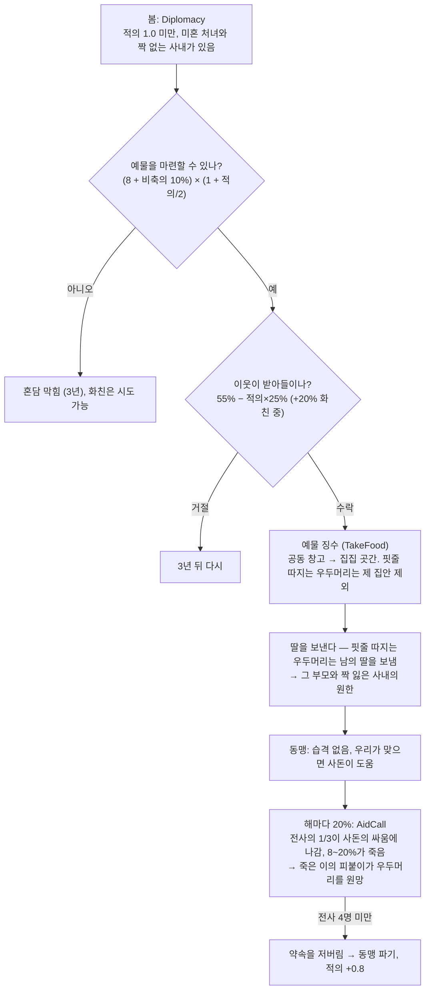
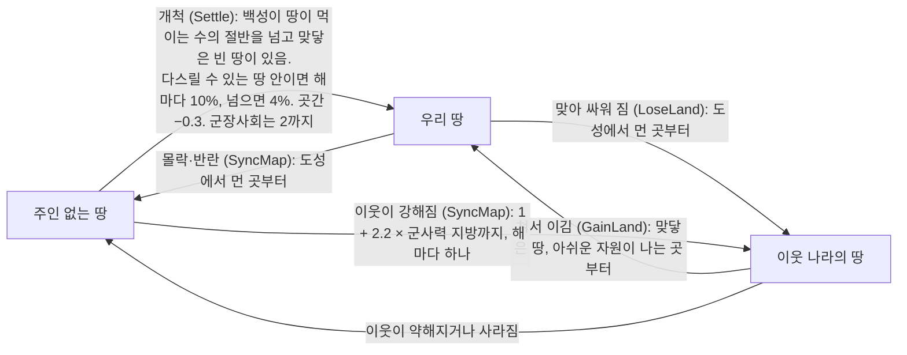
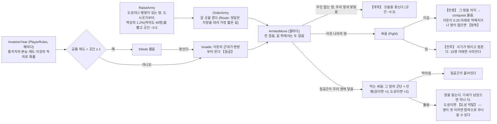

# 시뮬레이터 구조도

2026-11-17 그래픽 갱신: `tools/make-art.mjs`로 직접 제작한 SVG 98개를 `game/assets/`에 적용. `Art.Tex`가 PNG 다음 SVG를 읽고, `Cells`는 자원 표식 5종과 칸 건물 11종을 그림으로 표시한다. `Ui.Icon`은 컬러 아이콘의 RGB를 보존한다. 마을·지형·주민/병사 걷기 그림도 교체했다. UI는 청회색·황동 테두리로 통일하고 유리 흐림을 제거했다. `HudRes`의 자원판은 왼쪽 조작 패널 위에 이름이 붙은 2×2 배열로 배치했다. `HudTech`는 기술별 아이콘과 갈림길 아이콘을 사용하며 `HudWindows`의 법전 카드도 어두운 팔레트로 맞췄다. 제작 규격은 `ASSETS.md`에 기록한다.

> **이 문서는 코드와 함께 움직인다.** 시뮬레이터를 고치면 같은 작업 안에서 이 문서도 고친다.
> 제도·본능·소스 파일·한 철의 단계·이웃 무리 상태·이웃 나라 상태·나라 상태·계층·실행 옵션이 여기 빠져 있으면 `StructureDocTests`가 실패한다.
> 그림은 Mermaid다 — VS Code 미리보기(Ctrl+Shift+V, Mermaid 확장)나 GitHub에서 그림으로 보인다.

마지막 갱신: 2026-11-20 (**UI·게임성 개편: 나라 단계의 능동 외교 사절 `SendEnvoy`/`WhyCantEnvoy`(`trade`·`truce`·`ally`, 저장 명령 `envoy`)와 연간 국고 수지 예측 `ForecastTreasury`, 단계·시대 발전 나침반 `NextStageChecks`/`NextEraChecks` 및 상황별 행동 길잡이, 7종 블렌더 주민 스프라이트와 도성 주민 일상 분산, 상·하단 바 및 작업·건설·지역·외교 패널 시인성 개선**, **최적화·언어(조사)·화면 다듬기: 지형 장식 PNG 6종을 3×2 아틀라스(`Art.DecorAtlas`/`DecorQuad`)와 메시 하나로 묶어 틀마다 6,400번이 넘던 그리기 호출을 1번으로 줄임, 미탐사 안개 지역(`!Known`)의 지방 이름·마을·적군 그리기 및 클릭 차단, `IconButton`의 빈 아이콘 텍스처와 `Art.RoadCurve` 캐시, `HasFogEdge`/`Cells.CountSeen`/`WorldMap.Known`의 무할당 반복문, 칭호·계층·지명·창고의 한국어 조사(`Josa`) 바로잡기, 연대기·지역 패널·짓기 미리보기·사람들 태그·저장 슬롯·스크롤바·구분선·막대 바탕의 어두운 테마 가독성 개선, 하단 단추 줄과 오른쪽 아래 조작 안내의 겹침 해소, 일 탭·관리인 방침 줄·기술 창의 다음 시대 조건 안내 손질**, **화면 읽기 쉽게(다른 게임의 풀이를 따라): 민심의 갈래 `MoodPart`·`CohesionParts`/`LegitimacyParts`/`UnrestParts`/`RepressParts`(`RealmMood`가 그 합을 쓰고, 형편 막대의 툴팁이 목표값과 큰 갈래를 보인다), 일의 소출 어림 `Forecast`/`ForecastFood`(난수 없음 — 일 탭의 "+N/철"과 "이번 철 식량 +X · 먹는 양 −Y" 줄), 승리 조건의 ✓ 표, 법전 칸의 얻는 것·치르는 값 툴팁, 막힌 무리 행동 밑의 까닭, 아래 단추의 이름, 3분 뒤 접히는 조작 안내, 두 줄 배지**, **균형 손질(3시간 시험 기록과 직접 플레이로 찾은 것): 넘치는 집의 강제 나눔(`Feed` 2b), 아이 부양 부담의 출산 제동(`DependencyBrake`), 작은 무리에 대한 습격 자비와 끌려가는 사람 상한(`SmallBandMercy`, `MaxAbducted`), 한 해 공물 상한(`TributeBudget`), 죽음 원인 `추위`·`사고`(`DeathCause`), 몰락 뒤 40년 유예(`CollapseGrace`, 【위기】)와 15년 암흑기, 결속 기준 상향, 분열 확률 하향, 지식 속도 `KnowledgePace`, 경제 승리는 근대·교역 3단계·곳간 5, 영원한 독재는 30년, 계몽은 지식 2,200, 관리인 없는 건설 일손(`AutoBuilders`), 균형 점검 `tools/quick.mjs`**, **블렌더 그림과 사람의 움직임: `tools/blender/`(people·env·town)이 사람 6종의 8방향 걷기·짐 지기·일하기 시트와 나무·산·자원·칸 건물·집·도성·지방 건물을 같은 사진기·빛으로 렌더한다. 무리 시절의 사람(`Folk.cs`)은 맡은 일의 일터(지은 칸 건물, 없으면 그 일의 자원 칸)로 A* 길을 걸어가 도구를 휘두르고, 짐을 지고 창고로 돌아와 `Main.Deliver`로 "+n"을 띄운다(예전 `ActorLayer.Haul` 대신)**, **겨울나기 균형: 사냥·채집·고기잡이의 겨울 몫을 줄이고 가을 몫을 키웠으며(손놓은 무리는 가을에 모으고 겨울에 줄어 굶는 이가 나온다), 겨울 한 철은 추워서 창고가 덜 썩는다(`WinterRot`)**, **제도 건의는 기본으로 꺼짐(`Proposals`, 저장의 `proposals` 줄, `PlayerBot`만 켠다) — 제도는 법전의 시대별 제도 나무와 오른쪽 상세 칸에서 고르고 새로 들일 수 있는 제도는 오른쪽 배지로 알린다, 창고 `Storehouse`와 저장 한도 `StoreCap`(넘친 식량은 철마다 30% 썩는다), 겨울까지 남은 철을 보이는 날짜, 일 탭을 한 줄씩(네 철 소출 막대), 아래 단추 줄의 일·건설, 일터에서 창고로 짐을 나르는 사람(지금은 `Folk.cs`), 느려진 시간(1배 6초/철)**, **갈림길은 같은 시대에 여럿 익힐 수 있고 하나 더할 때마다 값이 50%씩 오른다(`CostOf`), 결정은 시간을 멈추지 않고 오른쪽 카드(`HudDecision.cs`)로 쌓여 바로 고르거나 "자세히"로 얻는 것·치르는 값을 크게 본다, 위 띠의 스타크래프트식 자원 줄과 쉬운 이름의 형편 막대(영토·불만·우두머리/통치자 지지·단합 — 예전 정통성·결속), `tools/make-icons.mjs`가 만드는 겹치지 않는 아이콘 77종**, **오른쪽 위 자원판 `HudRes.cs`와 지도 위에 떠오르는 자원 증감, 좁힌 왼쪽 패널, 시대별 기술 나무 그림 `HudTech.cs`**, **클라이언트의 일·건설 패널 `HudCamp.cs`, 칸 그림과 안개·짓기 표시 `Cells.cs`, 판을 열 때 일 나눠 두기**, **일과 칸 건물 `Labor.cs`(27절): 사람마다 일(`Work`)을 맡기고 일마다 사람 수를 나누기, 일마다의 정원, 관리인(`Steward`)과 방침, 칸 위에 짓는 건물 열한 가지(`Structures`)와 나무·돌, 정찰과 안개(`Seen`), 지도 96×60칸과 칸의 먹을거리(`Feature`), 한 철의 `Labor` 단계**, **길과 승리 `Courses.cs`와 `--aim`(26절): 기술의 갈림길 20개(16절, 시대마다 넷 가운데 하나), 정복·교역·공포·전제의 길과 다섯 승리(제국 건설·경제 승리·공포의 군림·영원한 독재·계몽), 식인 풍습 `Cannibalism`, 공포 `Dread`, 길을 노리는 `PlayerBot`**, 명령 기록과 저장·불러오기 `Saves.cs`, 무리의 일 `Tribe.cs`, 플레이어 흉내 `PlayerBot.cs`와 `--player`, 플레이어 규칙의 균형 측정과 조정(침공군의 집결·제곱 셈·수비 보정), Godot 클라이언트의 저장·소리·설정·사람들 창·유리 UI·부드러운 땅 경계·갈림길과 승리 창, 화면 문구 다듬기(곳간→국고 등, 할 수 없는 까닭 문구), 처음 안내와 상황 안내 HudGuide.cs, 난이도 `Difficulty.cs`와 `--difficulty`(25절), 저장 머리말의 `diff`, 씨족 이름의 색 머리말(`Names.NextClan`), 화면 최적화(나무·봉우리를 메시 하나로 `Pen.cs`, 국경 그림을 뒤에서, 화면 갱신을 틀마다 한 번), 재기 `bench.ps1`)

---

## 1. 한눈에 보기

핵심 생각은 하나다: **본능은 없앨 수 없고, 제도는 그 방향만 바꾼다. 그리고 모든 제도는 누군가에게 값을 치르게 한다.**

시뮬레이션은 **두 층**이다.



- 나라는 **지도 위의 땅**을 가진다. 영토(`Territory`)는 지방(`Province`)의 수이고, 개척·전쟁·몰락이 지도 위에서 일어난다(15절).
- 지식은 **기술 나무**로 흘러 들어간다. 기술이 제도와 자원을 연다(16절). **자원**은 시대마다 새것이 중요해지고, 없으면 사거나 빼앗는다(17절).
- 백성은 **계층 넷**(귀족·평민·예속민·노동자)으로 나뉜다. 제도마다 얻는 계층과 잃는 계층이 있어서, **제도를 들이거나 없애는 일 자체가 값을 치른다**(7절).
- 도시국가부터 국경 너머에 **이웃 나라**가 실제로 있다: 싸우고, 장사하고, 믿음과 문물과 소문을 실어 보낸다(8절).
- **부족** 단계에서는 이름 있는 사람이 무리의 전부다. **군장사회**가 되는 순간부터 이름 있는 사람들은 **지배 가문**이 되고, 그 아래 백성은 머릿수(`Pop`)와 감정으로만 그린다.
- 한 틱 = 한 철(봄·여름·가을·겨울), 4틱 = 1년. 나라 층은 해마다 겨울에 한 번 셈한다(`RealmYear`).
- 난수는 `Random(seed)` 하나뿐 → 같은 씨앗이면 같은 역사(테스트로 보장). 지도는 그 난수를 쓰지 않고 씨앗의 해시로만 만든다.
- 엔진과 무관한 순수 C#. 화면은 이 코어를 읽기만 한다.

---

## 2. 파일 지도

| 파일 | 맡은 일 |
|---|---|
| `src/Instinct.Sim/Person.cs` | 사람 한 명의 상태. 본능(`Trait`), 가족, 주인(`Master`), 식량, 지위, 원한(`Grudge`/`GrudgeWhy`) |
| `src/Instinct.Sim/Names.cs` | 사람·씨족 이름 짓기(씨족은 토템에 색 머리말 "흰·검은·붉은…"을 붙여 겹치지 않게, 다 쓰면 그때 숫자), 한국어 조사(`Josa`) |
| `src/Instinct.Sim/Simulation.cs` | 뼈대. `Config`, `Institutions`, 한 철의 순서(`Step`), 생산·분배·짝짓기·지위·폭력·출생·죽음, 자리의 세습 |
| `src/Instinct.Sim/War.cs` | 이웃 무리(`Neighbor`), 습격을 당함/약탈을 감, 종살이 (부족·군장사회 단계) |
| `src/Instinct.Sim/Diplomacy.cs` | 전쟁의 고리를 끊는 수단: 화친·공물·혼인 동맹(예물, 원군) |
| `src/Instinct.Sim/Catalog.cs` | **제도 목록**(`Catalog.All`): 키·이름·열리는 시대와 단계·얻는 것·값. 실행기와 화면이 모두 이것을 읽는다. 단계·시대·통치자 칭호의 이름 |
| `src/Instinct.Sim/Realm.cs` | **나라 층**: `Stage`·`Era`·`Realm`, 한 해의 셈(`RealmYear`), 살림·민심·사건·전쟁·봉기·몰락, 연간 국고 어림(`ForecastTreasury`)과 발전 조건(`NextStageChecks`·`NextEraChecks`). 민심의 목표값은 이름 붙은 갈래 목록(`MoodPart`, `CohesionParts`·`LegitimacyParts`·`UnrestParts`·`RepressParts`)의 합이라 화면이 "왜 이 값인가"를 그대로 보인다 |
| `src/Instinct.Sim/Estates.cs` | **계층과 개혁**: `Estate`, 개혁의 값 미리보기(`PreviewReform`)와 실행(`Enact`), 계층의 분노와 움직임, 입신(`Ascend`)과 낙향(`Decline`), 제도 자동 도입(`AutoPolicy`) |
| `src/Instinct.Sim/Rivals.cs` | **이웃 나라**(`Rival`): 적의, 화친, 교역, 혼인 동맹(`RoyalMarriage`), 플레이어의 외교 사절 파견(`SendEnvoy`·`WhyCantEnvoy`), 문물·믿음·소문의 전파 |
| `src/Instinct.Sim/Map.cs` | **지도와 영토**: `Terrain`, `Province`, `WorldMap`(씨앗에서 만든다), 땅을 얻고 잃기(`GainLand`/`LoseLand`), 지도 맞추기(`SyncMap`), 개척(`Settle`) |
| `src/Instinct.Sim/Tech.cs` | **기술 나무**: `TechDef`, `TechTree.All`(47개: 줄기 27 + 갈림길 20), 기술 → 제도의 문(`TechTree.Gate`), 연구(`SetResearch`/`ResearchYear`), 갈림길(`Crossroad`, 갈래를 더할수록 비싸지는 `CostOf`, `CrossroadChoice`, `AtCrossroad`) |
| `src/Instinct.Sim/Resources.cs` | **자원**: `Resource`, `ResourceCatalog`, 쓸 수 있는 정도(`Supply`), 발견(`Discover`), 자원이 낳는 사건(`ResourceEvents`) |
| `src/Instinct.Sim/Buildings.cs` | **건물과 길**(18절): `Building`, `BuildingCatalog`, 공사(`Site`, `Construction`), 유지비(`Upkeep`), 건물이 치르는 값(`BuildingsYear`), 길(`BuildRoad`, `PruneRoads`) |
| `src/Instinct.Sim/Labor.cs` | **일과 칸 건물**(27절): `Work`·`WorkCatalog`, 관리인(`Steward`, `StewardPolicy`, `Rebalance`), 칸 건물(`StructureKind`, `StructureCatalog`, `Structure`, `Place`/`Raze`), 정원(`Capacity`), 정찰과 안개(`Scouting`, `UpdateSight`, `FogEdge`), 한 철의 `Labor`. 소출 어림 `Forecast`/`ForecastFood`(운을 뺀 기댓값, `Produce`와 같은 `Crowd`·`JobCounts`·`ExpectedFood`를 쓴다) |
| `src/Instinct.Sim/Decisions.cs` | **결정**(19절): 플레이어에게 올라오는 물음(`Decision`, `Decide`), 제도 건의(`ProposeYear` — `Proposals`가 켜져 있을 때만, 기본은 꺼짐), 연대기의 무게와 갈래(`Chronicle`), `PlayerRules` |
| `src/Instinct.Sim/Armies.cs` | **지도 위의 군대**(20절): `Army`, 일으키기·흩기·명령(`RaiseArmy`/`DisbandArmy`/`OrderArmy`), 이웃 나라의 침공(`Invade`, `InvasionYear`), 철마다의 행군과 싸움(`ArmiesMove`) |
| `src/Instinct.Sim/Saves.cs` | **명령 기록과 저장**(22절): `Command`, `Journal`, 다시 내리기(`Replay`), 판의 지문(`Fingerprint`), 머리말의 `proposals` 줄(건의 켬), `SaveGame`(`Write`/`Read`/`Peek`/`Drifted`) |
| `src/Instinct.Sim/Tribe.cs` | **무리의 일**(23절): `TribeActions`(큰 사냥·잔치·선물 보내기·습격 명령), `WhyCantTribe`, `TribeAct` |
| `src/Instinct.Sim/PlayerBot.cs` | **플레이어 흉내**(24절): `PlayerRules` 판을 사람처럼 다스리는 `PlayerBot.Season` — 균형을 재는 데 쓴다 |
| `src/Instinct.Sim/Difficulty.cs` | **난이도**(25절): `Difficulty`(쉬움·보통·어려움), 문턱값을 미는 값(`StateBias`, `ThreatMul`, `FoeMul`, `ExpenseMul`, `UnrestBias`, `CrisisMul`, `YieldMul`), 이름 읽고 쓰기 |
| `src/Instinct.Sim/Courses.cs` | **길과 승리**(26절): `Course`(정복·교역·공포·전제·학문), `CourseLevel`, 나라의 기질 `Leaning`, 공포(`Dread`, `DreadFactor`, `Feared`), 식인 풍습의 값(`CannibalYear`, `EatTheDead`), 승리(`Victories`, `VictoryMet`, `VictoryNeeds`, `VictoryProgress`, `Won`) |
| `src/Instinct.Runner/Program.cs` | 콘솔 실행기. 옵션을 읽어 제도를 정해진 해에 켜고 연대기를 찍는다 |
| `src/Instinct.Web/Program.cs` | 화면용 작은 서버(이 PC 안에서만). `/api/state` `/api/step` `/api/toggle` `/api/auto` `/api/research` `/api/map` `/api/new` |
| `src/Instinct.Web/wwwroot/index.html` | 화면 한 장: 진행·빠르기, 요약, 자원, 사람 수·민심 그림, 지도, 연대기, 사람들, 기술 나무, 제도 켜고 끄기 |
| `src/Instinct.Web/wwwroot/map.js` | 지도 그림: 땅의 생김새, 국경, 시대 따라 자라는 마을과 도성, 자원 표시, 걸어 다니는 사람들, 전쟁·사건 표시 |
| `play.cmd` | 화면을 띄운다 (더블클릭 → 브라우저가 열림) |
| `tests/Instinct.Tests/DiplomacyTests.cs` | 이웃 무리와의 드문 경로를 강제로 밟는 테스트 + 결정성 |
| `tests/Instinct.Tests/RealmTests.cs` | 나라 층: 단계·시대·몰락, 재앙이 사람에게 닿는 경로, 제도 목록, 결정성 |
| `tests/Instinct.Tests/EstateTests.cs` | 개혁의 값과 반발, 분노한 계층의 움직임, 입신·낙향·백성 출신 왕조, 자동 도입 |
| `tests/Instinct.Tests/RivalTests.cs` | 이웃 나라: 교역·화친·혼인·전파·정복·함락, 몰락 갈래의 기록 |
| `tests/Instinct.Tests/MapTechTests.cs` | 지도(결정성·이어짐·자원), 땅을 얻고 잃기, 기술의 문과 연구, 자원의 공급과 사건, 화폐 가치 절하의 뜸, 귀족 반란 → 분열 |
| `tests/Instinct.Tests/PlayerTests.cs` | 플레이어의 손: 강과 땅결, 건물·길·유지비, 건의·구휼·정복·공물의 결정과 기한, 연대기의 무게, 군단(일으키기·개척·정복·패배), 침공(땅을 잃음·막아냄·도성 약탈) |
| `tests/Instinct.Tests/SaveTribeTests.cs` | 저장한 판을 불러오면 같은 판, 명령 기록, 무리의 일 넷, 침공군의 집결, 승산, 플레이어 흉내의 결정성 |
| `tests/Instinct.Tests/DifficultyTests.cs` | 난이도: 보통은 원래 규칙 그대로, 수확과 침공(잦기·적군 수)이 난이도 순서대로, 저장에 적히고 되살아난다 |
| `tests/Instinct.Tests/CourseTests.cs` | 길과 승리: 갈림길은 시대마다 여러 갈래를 고를 수 있고 더할수록 비싸진다, 기질을 따른 자동 선택, 플레이어는 갈림길에서 기다린다, 길의 값, 공포와 침공, 식인 풍습의 얻는 것과 값, 다섯 승리를 상태를 만들어 밟는다, 길을 노리는 판의 결정성과 저장 |
| `tests/Instinct.Tests/ReadoutTests.cs` | 화면 읽기: 민심의 갈래가 제도를 따라 움직이고 결속을 끄는 것, 억누름의 갈래, 소출 어림이 일하는 사람이 있어야 나오고 난수를 먹지 않는 것 |
| `tests/Instinct.Tests/BalanceTests.cs` | 균형 손질의 경로: 넘치는 곳간의 강제 나눔, 출산 제동, 작은 무리의 습격 자비·끌려가는 사람 상한, 공물 상한과 작은 무리의 면제, 관리인 없는 건설 일손, 죽음 원인의 갈래, 계몽의 지식 목표 |
| `tests/Instinct.Tests/StructureDocTests.cs` | 이 문서가 코드보다 뒤처지면 실패하는 테스트 |

---

## 3. 한 철의 순서 (`Simulation.Step`)

위에서 아래로, 코드의 호출 순서 그대로다. 괄호는 그 단계가 도는 조건. **"이웃"** 표시는 `Tribal`(부족·군장사회)일 때만 돈다 — 도시국가부터는 나라의 전쟁이 대신한다.

```mermaid
flowchart TD
    A["YearStart (봄)<br/>작황 결정·가뭄, 이웃 점검(NeighborYear → DiplomacyYear → AidCall), 이방인 도착(Arrivals)"]
    B["EnsureChief<br/>자리가 비면: 나라가 선 뒤에는 아들→같은 씨족, 그 전(또는 보통선거)에는 지위 1등"]
    C["Diplomacy (봄, 이웃)<br/>혼인 동맹 → 안 되면 화친 시도"]
    LB["Labor<br/>안개를 걷고, 일 없는 이에게 일을 주고(관리인이 있으면 모두 다시 나눈다), 정찰·건설 (27절)"]
    D["Produce<br/>맡은 일대로 식량(공동 창고 또는 제 곳간)·나무·돌을 얻는다"]
    F["Feed<br/>공동 분배 → 가구 → 넘치는 집의 강제 나눔 → 친족 나눔 → 도둑질 → 굶주림·아이 버리기"]
    T["ThrallLife<br/>종의 원한, 도망, 해방"]
    R["MaybeRaid (봄~가을, 이웃)<br/>약탈 제도 또는 제도 밖의 복수 원정"]
    U["PayTribute (가을, 이웃)<br/>공물을 바친다"]
    V["EnemyRaids (가을·겨울, 이웃)<br/>이웃이 쳐들어온다"]
    W["Courtship (봄·여름)<br/>짝짓기"]
    X["Affairs → PaternityDoubts<br/>불륜, 친자 의심"]
    Y["StatusContest (봄)<br/>우두머리 자리 다툼"]
    Z["EnvyTheft → Violence<br/>시샘 도둑질, 원한이 터져 폭행·살인"]
    AA["Births → Mortality<br/>출생(아이가 일손보다 많으면 준다), 병·노환·추위·사고로 죽음"]
    AB["Decay → NeighborDecay<br/>식량이 썩고, 원한·적의·복수심이 식는다"]
    PL["Construction → ArmiesMove → ExpireDecisions<br/>짓던 것이 한 철만큼 올라가고, 군대가 한 걸음 움직여 닿은 곳에서 싸우고, 기한이 지난 물음이 닫힌다 (18~20절)"]
    RY["RealmYear (겨울)<br/>나라의 한 해 — 아래 6~8절"]
    AC["YearEnd (겨울)<br/>한 해 요약을 연대기에 남긴다"]
    A --> B --> C --> LB --> D --> F --> T --> R --> U --> V --> W --> X --> Y --> Z --> AA --> AB --> PL --> RY --> AC
```



---

## 4. 본능 → 사건 → 제도

| 본능 (`Trait`) | 사람 층에서 생기는 일 | 나라 층에서 미는 것 (통치자·지배 가문) | 방향을 바꾸는 제도 |
|---|---|---|---|
| `Greed` 탐욕 | 몰래 쌓아두기, 시샘 도둑질, 유산 다툼 | 부패(가문 평균), 불평등(통치자) | `PrivateProperty`, `LawCode`, `Parliament` |
| `Libido` 성욕 | 불륜, 친자 의심, 짝 없는 사내의 공격성 | — | `Monogamy` |
| `Aggression` 공격성 | 폭행, 살인, 약탈 참가 | 전쟁 확률, 정변의 성패, 핵전쟁 확률 | `BloodMoney`, `Raiding`, `Parley` |
| `Ambition` 야심 | 우두머리 자리 다툼, 원정 부추김, 형의 세습을 시기 | 침략 전쟁, 정변을 일으키는 장수 | `StandingArmy`(값), `Surveillance`, `Suffrage` |
| `KinBias` 핏줄 편애 | 제 집안만 먹임·아낌, 이방인 미움, 복수심 | 부패(통치자), 박해·학살 확률(가문 평균) | `BloodMoney`, `Tolerance`, 모든 외교 제도에서 "누가 값을 내나" |
| `Empathy` 공감 | 나눔, 종 해방, 딸을 보낸 부모의 원망 | 불만을 낮춘다(통치자) | `Slavery`의 완충 |

---

## 5. 단계와 시대

### 정치 단계 (`Stage`) — 커지고, 무너진다



| `Stage` | 이름 | 통치자 | 달라지는 것 |
|---|---|---|---|
| `Tribe` | 부족 | 우두머리 | 사람 층만 돈다. 자리는 지위 1등 |
| `Chiefdom` | 군장사회 | 군장 | 나라 층 시작. 자리는 세습. 이웃 무리와의 약탈·외교는 계속 |
| `CityState` | 도시국가 | 통치자 | 이웃 무리 대신 나라의 전쟁(`RealmWar`). 몰락이 가능해진다 |
| `Kingdom` | 왕국 | 왕 | 자리가 바뀔 때 계승 전쟁. 식민지·절대왕정이 열린다 |
| `Empire` | 제국 | 황제 | 결속이 더 빨리 닳는다. 무너지면 두 단계 내려앉는다 |

(보통선거가 있으면 도시국가부터 통치자를 "수반"이라 부른다.)

**몰락**(`Collapse`): 백성의 30~50%와 영토의 2/3, 지식의 8%를 잃고 15년 암흑기(`DarkAgeUntil`, 지식이 절반 빠르기로 자란다), 30년 동안 다시 커지지 못한다(`RebuildUntil`). 결속은 새로 시작한다(`StateFounded`). 무너질 때마다 해와 갈래가 `Falls`에 남는다. 다시 선 지 40년(`CollapseGrace`, `InCollapseGrace`) 안에는 `함락`·`핵전쟁`이 아닌 몰락이 오면 무너지지 않고 【위기】로 흔들리기만 한다(정통성의 상처 +0.05, 결속 −0.05). 갈래는 일곱:

| 갈래 (`Falls`) | 조건 |
|---|---|
| `결속` | 결속 < 30% 이면서 불만 > 45% (해마다 4%). 과한 영토의 조건을 먼저 본다 |
| `봉기` | 봉기가 성공했는데 결속 < 30% (30%) |
| `과한 영토` | 다스릴 수 있는 것(`AdminCapacity`)보다 넓은 땅 + (정통성 < 60% 또는 결속 < 35%) (넘친 지방마다 8%) |
| `파산` | 곳간 −5 이하, 또는 빚(−2 아래)이 8년째 이어짐 (10%) |
| `분열` | 봉건제 + 귀족의 분노 > 30% + 정통성 < 55% (5%). 또는 왕국부터, 귀족 반란(`NobleRevolt`)이 났는데 결속 < 40% (20%) |
| `함락` | 맞아 싸운 전쟁에서 지고 영토 3 이하, 결속 < 50%거나 상대 군사력 > 1.0 |
| `핵전쟁` | 핵무장, 아주 낮은 확률. 군장사회까지 내려앉고 이웃 나라도 사라진다 |

다스릴 수 있는 땅(`AdminCapacity`) = 2 + 단계 + 다스림의 도구 ÷ 3(버림). 도구: 문자 1, 성문법 1, 봉건제 2, 절대왕정 1, 인쇄술 1, 민족주의 1, 바퀴와 길 1, 철도와 전신 2. 여기에 도성까지 길이 닿은 지방 셋마다 +1(`RoadCount` ÷ 3, 18절).

결속은 기준 0.68에서 불평등(×0.2)·부패·과한 영토·**나라의 나이**(해마다 0.08%, 최대 −25%)·단계가 깎는다 — 그래서 오래된 큰 나라는 언젠가 무너진다.

### 시대 (`Era`) — 지식이 쌓여 넘어간다

| `Era` | 이름 | 지식 | 그 밖의 조건 | 새로 생기는 문제·현상 |
|---|---|---|---|---|
| `Primitive` | 원시 | 0 | — | 굶주림, 약탈, 복수 |
| `Ancient` | 고대 | 40 | 군장사회 | 기근, 세금, 정변, 노예 반란 |
| `Medieval` | 중세 | 220 | 문자, 도시국가에 닿은 적 있음 | 큰 돌림병, 마녀사냥, 농민 반란, 귀족 반란 |
| `EarlyModern` | 근세 | 600 | 화폐, 왕국에 닿은 적 있음 | 종교 전쟁, 식민지 수탈·봉기, 화폐 가치 절하 |
| `Industrial` | 근대 | 1300 | 인쇄술 | 공장 화재·빈민가·파업, 총력전, 학살, 혁명 |
| `Modern` | 현대 | 2600 | 공장제, 의무교육 | 공황, 기후 재난, 숙청, 식민지 독립, 핵전쟁 |

지식은 사람 수(로그)·도시화·제도가 민다. 암흑기에는 절반으로 준다. 모든 증가에 `KnowledgePace`(1.3)를 곱한다. 해마다 쌓인 만큼이 그대로 **지금 파고드는 기술**로도 흘러간다(16절) — 시대에 들어서도 그 제도를 여는 기술을 익혀야 제도를 들일 수 있다.

---

## 6. 나라의 한 해 (`RealmYear`)



### 나라의 상태 (`Realm`)

| 필드 | 뜻 |
|---|---|
| `Stage`, `PeakStage`, `Era` | 지금 단계, 닿아 본 가장 높은 단계(제도와 시대의 문을 연다), 시대 |
| `Pop`, `Territory` | 백성 수, 영토(지도에서 우리가 가진 지방의 수. 한 지방이 먹이는 사람 수는 시대·땅의 기름짐·기술·자원이 정한다 — `LandCapacity`) |
| `Treasury` | 곳간. 한 해 세입을 1로 본 단위, 음수는 빚. 조세가 있으면 −6 ~ 12, 없으면 곳간이라 할 것이 없어 −1 ~ 3. 3을 넘는 몫은 부패와 통치자의 탐욕이 해마다 갉아먹는다 |
| `Knowledge` | 쌓인 지식 → 시대 |
| `Unrest` | 겉으로 드러난 불만. 50%를 넘으면 봉기가 날 수 있다(불만 60% 초과일 때 해마다 (불만 − 50%) × 0.35). 나라의 힘은 군대 × (0.4 + 정통성) × 5로 맞선다 |
| `Suppressed` | 억눌러 숨긴 불만. 기근·패전·통치자 교체·봉기 때 한꺼번에 불만으로 터진다 |
| `Legitimacy`, `LegitShock` | 정통성과, 거기 남은 최근의 충격(패전·기근·찬탈) |
| `Inequality`, `Corruption` | 불평등, 부패 (왕조가 늙을수록 부패가 는다) |
| `Cohesion` | 결속. 군대의 힘이자 몰락의 문턱 |
| `Urban`, `Pollution` | 도시화(지식과 역병을 민다), 오염(땅을 깎고 기후 재난을 부른다) |
| `FoundedYear`, `DynastyClan` | 지금 왕조가 선 해와 그 씨족 |
| `StateFounded`, `RebuildUntil`, `DarkAgeUntil` | 지금 나라가 선 해, 재건이 끝나는 해, 암흑기가 끝나는 해 |
| `Collapses`, `Atrocities` | 몰락 횟수, 나라의 이름으로 저지른 학살·정복(정통성을 영영 깎는다) |
| `Falls` | 몰락의 기록: "해\|갈래" (5절의 표) |
| `Share` | 계층 넷이 백성 가운데 차지하는 몫 (귀족·평민·예속민·노동자 순, 합 1) |
| `Grievance` | 계층마다 개혁으로 쌓인 분노. 해마다 10%씩 식는다 |
| `ReformHeat` | 최근에 고친 제도의 수. 클수록 다음 개혁의 값과 반발이 커진다. 해마다 40%씩 식는다 |
| `Heresy` | 장삿길로 들어와 백성 사이에 퍼진 낯선 믿음 (0 ~ 0.6) |
| `Dread` | 공포(0 ~ 150): 약탈·노예제·식인 풍습·학살·이긴 싸움으로 쌓이고 해마다 3%씩 옅어진다. 높을수록 이웃이 덜 쳐들어오고(`DreadFactor`) 공포의 군림 승리에 다가간다 — 26절 |

### 나라의 사건이 사람에게 닿는 길

| 사건 | 조건 | 이름 있는 사람에게 일어나는 일 |
|---|---|---|
| 역병 (`Plague`) | 도시화·세계화·식민지가 민다. 중세·근세엔 큰 돌림병 | 지배 가문도 같은 비율로 죽는다(`역병`). 농노제면 살아남은 농노가 품삯을 요구 |
| 마녀사냥 (`WitchHunt`) | 종교재판, 또는 국교 + 역병·흉년 | **가장 미움받는 이**(여자·바깥 핏줄일수록)가 불탄다(`화형`). 고발자는 그에게 가장 큰 원한을 품은 사람 |
| 전쟁·총력전 (`RealmWar`) | 통치자의 공격성·야심, 약탈·민족주의·식민지, 그리고 이웃 나라의 적의 | 사내들이 죽는다(`전쟁`). 징병제면 백성이 떼로 죽는다. 지면 땅을 잃고(`LoseLand`), 땅이 얼마 없으면 함락. 쳐서 이기면 맞닿은 땅을 빼앗고(`GainLand`), 약해진 이웃이면 정복(그 나라가 사라진다). **살 길조차 없는 자원을 가진 이웃**은 칠 까닭이 하나 더 있고, 이기면 그 자원이 나는 땅부터 빼앗는다 |
| 석유 파동 (`ResourceEvents`) | 현대, 내연기관을 아는데 석유를 자급하지 못함 (해마다 4%) | 곳간 −1, 불만 +8%, 위기의 해가 된다 |
| 정변 (`Coup`) | 상비군 + 빈 곳간 또는 낮은 정통성 | 가장 야심 있는 사내가 통치자를 몰아내거나 죽인다. 실패하면 제가 죽는다 |
| 귀족 반란·종교 전쟁 | 봉건제 + 낮은 정통성, 또는 귀족의 분노 / 국교 − 종교 관용 + (인쇄술 또는 낯선 믿음 `Heresy`) | 사내들이 죽고 땅·결속을 잃는다 |
| 계승 전쟁 | 왕국부터, 통치자가 바뀔 때 | 사내들이 죽는다 |
| 학살 (`Persecution`) | 민족주의 + 위기. 선전이 부추기고 관용·선거가 줄인다 | 바깥 핏줄(`Outsider`)인 사람이 죽는다(`학살`). 결속은 오르고 불만은 숨는다 |
| 숙청 (`Purge`) | 선전 + 감시 | **통치자가 원한을 품은 사람**이 사라진다(`숙청`). 그 피붙이가 통치자를 원망 |
| 봉기 (`Uprising`) | 불만 60% 초과, 또는 예속민의 분노. 수가 많고 분노가 큰 계층이 앞장선다: 노예 반란 / 농민 반란 / 민란 / 혁명 | 성공하면 통치자가(혁명이면 윗자리 셋도) `처형`. 농노제·절대왕정·종교재판·봉건제(·노예제)가 무너진다. 60%의 확률로 **봉기를 이끈 백성이 빈자리에 앉아 새 왕조를 연다**. 혁명은 보통선거를 낳거나, 새 독재(선전+감시)를 낳는다 |
| 핵전쟁 | 핵무장, 아주 낮은 확률(위기의 해엔 3배) | 백성 80%, 지배 가문 70%가 죽는다(`핵전쟁`). 군장사회로 |

---

## 7. 계층과 개혁 (`Estates.cs`)

### 계층 넷 (`Estate`)

| `Estate` | 이름 | 몫(`Share`)이 향하는 곳 | 분노(`EstateAnger`)의 바탕 | 분노하면 |
|---|---|---|---|---|
| `Nobles` | 귀족 | 3% (+2% 봉건제). 수는 적어도 힘(`EstatePower`)은 0.1~0.7 | 낮은 정통성, 절대왕정·보통선거·복지·노동법 (봉건제는 달랜다) | 55% 초과: 정변(상비군) 또는 귀족 반란. 봉건제 아래서는 나라가 `분열`로 무너질 수 있다 |
| `Commoners` | 평민 | 나머지 | 나라의 불만(`Unrest`) 그대로 | 봉기(민란·혁명)의 몸통 |
| `Bound` | 예속민 | 노예제 10% + 농노제 35% (최대 50%) | 불평등과 불만 | 60% 초과: 노예 반란·농민 반란 |
| `Workers` | 노동자 | 도시화 × (공장제 70%, 아니면 15%) | 노동법 없는 공장제, 불평등 (복지·선거가 달랜다) | 60% 초과: 총파업(곳간 −0.4, 불만) / 혁명의 몸통 |

몫은 해마다 목표를 향해 8%씩 움직인다(`EstatesYear`). 분노 = 바탕 + 개혁으로 쌓인 것(`Grievance`). 평민·예속민·노동자의 `Share × Grievance`는 나라의 불만에 더해진다.

### 개혁의 값 (`PreviewReform` → `Enact`)

제도를 **들이면 잃는 계층이, 없애면 누리던 계층이** 반발한다(9절 표의 마지막 두 열). 실행기·화면·자동 도입이 모두 `Enact`를 거친다.



`AutoPolicy.Year`(`--auto`, 화면의 "제도 자동 도입")는 해마다 60% 확률로 쓸 수 있는 제도 하나를 고르되, 개혁의 열기가 남아 있거나 값을 치르면 곳간이 −1 아래로 내려가면 건너뛴다. 그에 앞서 `Works`가 남는 돈으로 길과 건물을 짓는다: 곳간이 3.5 이상이고 유지비가 0.12 아래이며 공사가 둘 미만일 때 해마다 50%, 짓고도 2.5가 남는 것만(18절).

### 솟는 사람, 밀려나는 가문 (`CourtYear`)

| 길 | 조건 | 일어나는 일 |
|---|---|---|
| 입신 (`Ascend`) | 해마다 2% + 화폐·길드·상비군·의무교육·공장제·보통선거가 올리고 봉건제·농노제가 내린다 | 백성 출신 용사·거상·장수·서기·학자·공장주·연설가가 아내와 함께 **새 가문**을 열어 윗자리에 오른다(`RiseFromCommons`). 핏줄을 따지는 오랜 집안 넷이 그를 미워한다 |
| 봉기의 지도자 | 봉기 성공 시 60% | 백성(또는 종이었던 자)이 통치자가 되고 왕조가 바뀐다. 오랜 집안 다섯이 원한을 품는다 |
| 낙향 (`Decline`) | 이름 있는 사람이 120명을 넘음 | 통치자와 먼 방계 가운데 지위가 가장 낮은 집(가장·아내·어린 자식)부터 백성 속으로 내려앉는다(`낙향`) |

---

## 8. 이웃 나라 (`Rivals.cs`, 도시국가부터)

도시국가가 되면 이웃 무리(10절)는 사라지고 국경 너머에 나라 셋이 나타난다(`EnsureRivals`). 해마다 3% 확률로 새 세력이 일어선다(최대 넷). 정복하면 사라진다.

| 필드 (`Rival`) | 뜻 |
|---|---|
| `Id`, `Name` | 번호와 이름 (단계에 따라 도시 동맹·왕국·제국·칸국 …) |
| `Seat` | 도성이 있는 지방의 번호(−1 = 아직 지도에 자리가 없음). 땅은 군사력만큼 넓어진다: 1 + 2.2 × `Strength` 지방(1~6), 해마다 하나씩 |
| `Strength` | 군사력(0.15~2). 전쟁에서 우리 군대와 맞선다. 이기면 깎이고 지면 큰다. 내란으로 반토막 나기도 한다 |
| `Hostility` | 우리를 향한 적의(0~1). 전쟁 확률, 교역, 화친, 혼인을 정한다 |
| `Faith` | 믿음. 0이면 우리와 같고, 아니면 다른 믿음(국교가 있고 관용이 없으면 적의가 오른다) |
| `Advance` | 그 나라의 지식. 우리보다 앞서면 장삿길로 문물이 들어온다 |
| `Trade` | 장삿길이 열려 있나 |
| `Allied` | 혼인 동맹 (한 번에 한 나라와만) |
| `Free` | 백성이 통치자를 뽑는 나라 (근대부터 생긴다) |
| `TreatyUntil` | 화친이 끝나는 해 (0 = 없음) |



적의를 올리는 것: 다른 믿음(국교 − 관용), 약탈, 민족주의, 식민지, 통치자의 공격성, 전쟁. 내리는 것: 화친 제도, 교역, 혼인 동맹, 공물.

**장삿길로 오는 것** (교역 중인 나라마다, 해마다):

| 오는 것 | 조건 | 결과 |
|---|---|---|
| 세입 | 늘 | 곳간 +0.08 (세계화면 1.5배) |
| 문물 | 그 나라의 `Advance`가 우리 지식보다 큼 | 지식이 그 차이의 3%만큼 따라붙는다 |
| 낯선 믿음 | 그 나라의 `Faith`가 다름 | `Heresy` +0.6% (인쇄술 1.5배, 종교재판 0.3배). 국교가 있고 관용이 없으면 결속이 깎이고 마녀사냥·종교 전쟁이 는다. 관용이 있으면 오히려 지식이 자란다 |
| 소문 | 그 나라가 `Free`이고 우리에게 보통선거가 없음 | 평민·노동자의 `Grievance`가 해마다 쌓인다 |
| 병 | 늘 | 역병 확률이 오른다 |

**혼인 동맹**(`RoyalMarriage`): 15~30세 미혼 여자 하나가 `시집감`으로 떠난다. 핏줄을 따지는 통치자는 제 딸 대신 남의 딸을 보내고, 그 부모가 통치자를 원망한다. 지참금 0.5. 맞아 싸울 때 사돈이 돕는 대신, 해마다 6% 확률로 사돈의 전쟁에 우리 사내들이 나가 죽는다.

**플레이어의 외교 사절**(`SendEnvoy`, 한 철에 한 번, 저장 명령 `envoy`): 해마다 도는 자연 전이 외에도 플레이어가 국고를 들여 직접 교역(`trade`, 국고 −0.4, 화폐·길드·세계화 중 하나와 적의 < 60% 필요)·화친(`truce`, 국고 −0.35/`Parley` 없으면 −0.6, 집결 중인 침공군 철수, 귀족 불만)·혼인 동맹(`ally`, 국고 −0.5, `RoyalMarriage`)을 맺을 수 있다.

---

## 9. 제도 표 (플레이어의 손잡이)

`Catalog.All`과 같은 순서다. "열리는 때"는 그 시대에 들어섰고 그 단계에 닿아 본 적이 있어야 한다는 뜻이다. 거기에 더해 **그 제도를 여는 기술**을 알아야 한다(16절의 표; 원시의 관습들과 국교는 기술 없이도 된다). 핵무장은 우라늄도 있어야 한다. 왜 못 들이는지는 `WhyUnavailable`이 말해 준다. 마지막 두 열은 그 제도로 얻는 계층과 잃는 계층(`Catalog.Stance`) — 들이면 잃는 쪽이, 없애면 얻던 쪽이 반발한다(7절).

| 제도 (`Institutions`) | 실행 옵션 | 이름 | 열리는 때 | 얻는 것 | 치르는 값 | 얻는 계층 | 잃는 계층 |
|---|---|---|---|---|---|---|---|
| `PrivateProperty` | `--private` | 사유재산 | 원시 · 부족 | 일한 만큼 갖는다. 야심이 일을 시킨다 | 빈부 차, 시샘 도둑질, 유산 다툼. 불평등이 자란다 | 귀족 | 평민 |
| `Monogamy` | `--monogamy` | 일부일처 | 원시 · 부족 | 짝 없는 사내가 줄어 폭력이 준다 | 힘센 자의 불만. 불륜은 그대로 | 평민 | 귀족 |
| `BloodMoney` | `--bloodmoney` | 피값 | 원시 · 부족 | 살인이 복수의 사슬로 번지지 않는다 | 못 갚는 자는 (노예제가 있으면) 종이 된다 | 평민 | 귀족 |
| `Raiding` | `--raiding` | 약탈 | 원시 · 부족 | 식량·여자·종을 빼앗아 온다 | 사내가 죽고 되갚음을 부른다. 나라가 되면 전쟁이 잦다 | 귀족 | 평민 |
| `Slavery` | `--slavery` | 노예제 | 원시 · 부족 | 포로와 빚진 자의 노동 | 종의 원한과 도망, 노예 반란, 불평등 | 귀족 | 예속민 |
| `Parley` | `--parley` | 화친 | 원시 · 부족 | 선물로 싸움을 멈춘다. 나라가 되면 전쟁이 준다 | 선물 값, 피붙이 잃은 이들의 원한 | 평민 | 귀족 |
| `Tribute` | `--tribute` | 공물 | 원시 · 부족 | 바쳐서 침략을 물린다 | 해마다 느는 요구, 꺾이는 위신 | 평민 | 귀족 |
| `MarriageAlliance` | `--alliance` | 혼인 동맹 | 원시 · 부족 | 사돈이 싸움을 돕는다 | 지참 예물, 딸을 보냄, 남의 싸움에 끌려감 | 귀족 | 평민 |
| `Agriculture` | `--agriculture` | 농경 | 원시 · 부족 | 땅이 더 많은 사람을 먹인다. 군장사회로 가는 문 | 흉년에 무너지는 인구, 역병, 쌓이는 잉여가 낳는 불평등 | 평민 | — |
| `Cannibalism` | `--cannibalism` | 식인 풍습 | 원시 · 부족 | 굶어 죽은 이와 쓰러진 적이 식량이 된다(굶주림·버려짐으로 죽은 이 하나에 곳간 +3, 이긴 약탈에서 적 사망자 × 1.5). 공포가 쌓여 이웃이 덜 쳐들어온다 | 떨림병(해마다 20%로 어른 하나가 병들거나 죽는다), 혼인 동맹을 못 맺고 이웃의 적의가 해마다 오른다. 나라가 되면 정통성 −0.06, 역병, 장삿길이 닫힌다(해마다 15%). 기근이나 위기가 있어야 건의된다 | — | — |
| `Writing` | `--writing` | 문자 | 고대 · 군장사회 | 지식이 쌓이고 세금을 셀 수 있다 | 글을 아는 계층이 따로 선다 | 귀족 | — |
| `Taxation` | `--taxation` | 조세 | 고대 · 군장사회 | 나라 살림이 생긴다. 도시국가로 가는 문 | 거두는 만큼 민심이 떠난다 | 귀족 | 평민 |
| `LawCode` | `--lawcode` | 성문법 | 고대 · 군장사회 | 부패가 줄고 더 넓은 땅을 다스린다 | 법은 가진 자의 편이다. 신분이 굳는다 | 평민 | 귀족 |
| `StandingArmy` | `--army` | 상비군 | 고대 · 군장사회 | 강한 군대, 반란 진압 | 급료, 그리고 야심 있는 장수의 정변 | 귀족 | 평민 |
| `StateReligion` | `--religion` | 국교 | 고대 · 군장사회 | 결속과 정통성 | 지식이 더디고 이단을 박해한다 | 귀족 | — |
| `Coinage` | `--coinage` | 화폐 | 고대 · 도시국가 | 장사와 세입이 는다 | 부가 쏠리고, 재정이 궁하면 돈의 값을 깎는다 | 평민 | — |
| `Feudalism` | `--feudalism` | 봉건제 | 중세 · 도시국가 | 싼값에 군대와 넓은 영토 | 세입을 귀족과 나눈다. 귀족 반란 | 귀족 | 평민 |
| `Serfdom` | `--serfdom` | 농노제 | 중세 · 도시국가 | 땅이 더 많이 낸다 | 깊은 불평등, 농민 반란 | 귀족 | 예속민·평민 |
| `Guilds` | `--guilds` | 길드 | 중세 · 도시국가 | 도시와 기술이 자란다 | 독점과 텃세로 부가 쏠린다 | 평민 | 노동자 |
| `Inquisition` | `--inquisition` | 종교재판 | 중세 · 도시국가 | 불만이 겉으로 드러나지 않고 결속이 는다 | 마녀사냥, 지식의 후퇴, 억눌린 분노 | 귀족 | 평민 |
| `Printing` | `--printing` | 인쇄술 | 근세 · 도시국가 | 지식이 빠르게 퍼진다 | 선동과 종교 분열도 같이 퍼진다 | 평민 | 귀족 |
| `Colonialism` | `--colonialism` | 식민지 | 근세 · 왕국 | 막대한 부 | 수탈과 학살, 식민지 봉기, 잦은 전쟁 | 귀족 | — |
| `Absolutism` | `--absolutism` | 절대왕정 | 근세 · 왕국 | 정통성, 귀족을 누른다 | 부패, 억눌린 불만, 혁명이 나면 더 크게 난다 | — | 귀족 |
| `Parliament` | `--parliament` | 의회 | 근세 · 도시국가 | 부패와 불만이 준다 | 더딘 결정으로 군대가 약해진다 | 귀족·평민 | — |
| `Tolerance` | `--tolerance` | 종교 관용 | 근세 · 도시국가 | 지식이 자라고 종교 전쟁이 없다 | 결속이 느슨해진다 | 평민 | 귀족 |
| `Factories` | `--factories` | 공장제 | 근대 · 도시국가 | 생산과 인구 부양력이 뛴다 | 아동 노동, 빈민가, 오염, 벌어지는 격차 | 귀족 | 노동자 |
| `LaborLaws` | `--laborlaws` | 노동법 | 근대 · 도시국가 | 격차와 불만이 준다 | 세입이 조금 준다 | 노동자 | 귀족 |
| `PublicSchooling` | `--schooling` | 의무교육 | 근대 · 도시국가 | 지식과 국민의 결속 | 돈이 든다 | 평민·노동자 | 귀족 |
| `Nationalism` | `--nationalism` | 민족주의 | 근대 · 도시국가 | 강한 결속과 군대 | 전쟁, 그리고 소수 집단 박해와 학살 | 평민 | — |
| `Conscription` | `--conscription` | 징병제 | 근대 · 도시국가 | 압도적인 군대 | 총력전: 전쟁이 나면 백성이 떼로 죽는다 | 귀족 | 평민·노동자 |
| `Suffrage` | `--suffrage` | 보통선거 | 근대 · 도시국가 | 정통성, 혁명 대신 선거 | 현대에는 갈라진 여론이 결속을 깎는다 | 평민·노동자 | 귀족 |
| `Welfare` | `--welfare` | 복지국가 | 현대 · 도시국가 | 격차와 불만이 준다 | 큰 지출, 낮아지는 출산 | 평민·노동자 | 귀족 |
| `Propaganda` | `--propaganda` | 선전 | 현대 · 도시국가 | 정통성과 결속 | 억눌린 불만, 학살을 부추긴다 | 귀족 | — |
| `Surveillance` | `--surveillance` | 감시 | 현대 · 도시국가 | 불만과 정변을 누른다 | 숙청, 지식의 후퇴, 억눌린 분노 | 귀족 | 평민·노동자 |
| `NuclearArms` | `--nuclear` | 핵무장 | 현대 · 도시국가 | 큰 전쟁이 드물어진다 | 아주 낮은 확률로 모든 것이 끝난다 | — | — |
| `Globalization` | `--globalization` | 세계화 | 현대 · 도시국가 | 생산과 지식 | 격차, 느슨한 결속, 빠르게 번지는 역병 | 귀족 | 노동자 |
| `GreenLaw` | `--greenlaw` | 환경 규제 | 현대 · 도시국가 | 오염이 줄어든다 | 세입이 조금 준다 | 평민 | 귀족 |

공통 실행 옵션: `--seed N`, `--years N`, `--verbose`(사소한 일도 출력), `--quiet`(연 요약만), `--auto`(`AutoPolicy`: 쓸 수 있게 된 제도를 해마다 하나쯤, 값을 치를 수 있을 때만 도입 — 끝까지 돌려 보는 용도), `--player`(`PlayerRules`를 켜고 `PlayerBot`이 다스린다 — 플레이어 규칙의 균형을 재는 용도, 끝에 개척·침공·방어의 수를 찍는다), `--aim conquest|commerce|terror|tyranny|learning`(`--player`를 켜고 흉내가 그 길과 승리를 노린다 — 24·26절, 끝에 길의 단계·공포·승리와 노린 승리까지 남은 것을 찍는다), `--difficulty easy|normal|hard`(난이도, 기본 normal — 25절), `--list`(제도 목록).
제도 뒤에 `@년`을 붙이면 그 해 봄에 도입한다 (예: `--private@30`). 아직 열리지 않은 제도는 열리는 해에 도입된다. 어느 쪽이든 `Enact`를 거치므로 값과 반발이 따른다. 끝의 요약에는 몰락의 갈래, 이웃 나라, 계층의 몫과 분노가 찍힌다.

---

## 10. 이웃 무리와의 관계 (부족·군장사회)



이웃 한 무리(`Neighbor`)가 가진 상태:

| 필드 | 뜻 |
|---|---|
| `Name`, `ClanId` | 이름과 씨족 번호 (끌려온 사람의 출신) |
| `Fighters` / `MaxFighters` | 지금 전사 수 / 회복 상한 |
| `Food` | 털 수 있는 식량 |
| `Hostility` | **그들이 우리에게** 품은 적의 → 습격 확률, 화친·혼인 수락 확률, 예물 크기 |
| `Vengeance` | **우리가 그들에게** 품은 복수심 → 원정 확률. 1.5를 넘으면 제도가 막아도 간다 |
| `Mourners` | 그 무리에게 피붙이를 잃은 사람들 → 평화를 맺으면 우두머리를 원망, 복수 원정의 선봉 |
| `PeaceUntil` | 화친이 끝나는 틱 (0 = 화친 없음) |
| `Allied`, `Bride` | 혼인 동맹 여부, 시집온 며느리(살아 있는 동안 동맹 유지) |
| `NextTalkTick` | 다음 교섭 가능 시점 (3년 간격) |
| `NextAllianceTick` | 예물을 못 마련해 혼담이 막힌 뒤 다시 청할 수 있는 시점 |
| `PaidTick`, `TributeYears` | 마지막 공물 시점, 연속으로 바친 햇수(요구가 는다) |

### 혼인 동맹의 흐름



도시국가가 되면 이웃 무리는 사라지고, 같은 제도들이 **이웃 나라**(8절)에 작용한다: `Raiding`은 적의와 침략을 늘리고, `Parley`는 화친을 사게 하고, `Tribute`는 곳간을 내주고 침략을 물리며(상대는 그만큼 강해진다), `MarriageAlliance`는 방어전을 돕는 대신 사돈 나라의 전쟁에 군사를 보내게 한다.

---

작은 무리는 덜 노려진다: 이웃의 습격 확률에 사람 수 ÷ 15(0.2~1, `SmallBandMercy`)를 곱하고, 습격에 끌려가는 사람은 10명 미만이면 없고 그 위로는 사람 수의 1/4까지다(`MaxAbducted`). 공물(`PayTribute`)은 8명 미만인 무리에게는 요구되지 않고, 한 해에 모든 이웃에게 바치는 몫의 합이 식량의 1/4과 사람 수 × 0.5 가운데 큰 것을 넘지 않는다(`TributeBudget`). 적의가 큰 이웃부터 받아 간다.

## 11. 사람이 무리를 떠나는 길 (`DeathsByCause`)

사람 층: `굶주림`, `살해`, `전쟁`(습격 방어·원정·원군·나라의 전쟁), `병`(젖먹이·앓던 몸, 건강한 어른의 갑작스러운 죽음의 일부)·`노환`(55세 이상)·`추위`(겨울, 건강한 어른)·`사고`(맡은 일에 따라 물에 빠짐·짐승·나무·돌더미·짓던 것·벼랑·독사, `DeathCause`·`AccidentText`), `출산`, `버려짐`(굶는 해의 갓난아이), `납치`(이웃에게 끌려감), `도망`(종), `공물`(종을 넘김), `시집감`(혼인 동맹), `사냥`(플레이어가 벌인 큰 사냥에서 돌아오지 못함, 23절).
- 굶주림을 줄이는 것: 우두머리가 있고 굶는 자유민이 있으면, 제 식구 세 철치를 넘게 쥔 집(가장의 식량 > 3)이 넘는 몫을 내놓아 다른 집의 굶는 이를 먹인다(`Feed` 2b, 사유재산 아래서는 절반만). 욕심 많은 가장(> 0.5)은 우두머리에게 원한을 품고, 우두머리의 위신이 오른다. 출산은 아이(14세 미만)가 일손(14~59세)의 0.8배를 넘으면 줄어 1.4배에서 0.4배가 된다(`DependencyBrake`).

나라 층: `역병`, `화형`(마녀사냥), `처형`(봉기·혁명), `숙청`, `학살`, `핵전쟁`, `낙향`(윗자리에서 밀려나 백성 속으로), 그리고 나라끼리의 혼인 동맹으로 떠나는 `시집감`.
죽음과 이탈을 통계에서는 한데 센다.

---

## 12. 화면 (`src/Instinct.Web`)

`play.cmd`를 더블클릭하면 작은 서버가 뜨고 브라우저에 `http://localhost:5177`이 열린다. 서버가 `Simulation`을 쥐고, 페이지는 그것을 읽어 그리고 제도를 켜고 끌 뿐이다(코어는 화면을 모른다).

| 화면의 곳 | 보여 주는 것 | 읽는 것 |
|---|---|---|
| 머리줄 | 해·철, 시대·단계·통치자, 진행/멈춤, 빠르기, +1년/+10년, 제도 자동 도입, 씨앗·새 역사 | `/api/step`, `/api/auto`, `/api/new` |
| 왼쪽 | 다음 단계·시대의 조건(`NextStageNeeds`, `NextEraNeeds`), 요약 숫자(몰락의 해와 갈래, 영토와 다스릴 수 있는 땅, 땅이 먹이는 수, 익힌 기술 수 포함), **자원**(자급 / 사서 쓴다 / 없다, 가진 이웃, 아직 못 알아보는 것은 필요한 기술), **계층**(몫·분노·개혁으로 쌓인 것), **이웃 나라**(군사력·적의·관계, 퍼진 낯선 믿음), 사람 수 그림(로그 눈금 + 단계 띠), 민심 그림(불만·정통성·결속·불평등), 표로 보기 | `History`, `Realm.Share`, `EstateAnger`, `Rivals`, `Realm.Falls`, `AdminCap`, `LandCapacity`, `Supply` |
| 가운데 위: 땅 | **지도**(`map.js`). 땅의 생김새(들·숲·언덕·산·초원·바다), 나라마다 색이 다른 국경, 단계와 시대에 따라 천막 → 마을 → 성 → 공장 굴뚝으로 자라는 도성과 마을, 우리 땅마다 사는 백성 수(`LandPops`)만큼 늘어나는 집, 이웃 나라의 도성, 부족 때의 이웃 무리, 드러난 자원, 장삿길과 동맹의 선, 주인이 바뀐 땅의 번쩍임, 전쟁 표시, 큰 사건의 알림. **이름 있는 사람들이 걸어 다닌다**(최대 28명: 씨족마다 옷 색, 통치자는 관, 종은 잿빛, 아이는 작게) — 사람이나 땅에 마우스를 올리면 설명이 뜬다 | `/api/map`(생김새, 한 판에 한 번), `/api/state`의 `lands`·`landPop`·`rivals`·`bands`·`people` |
| 가운데 아래 | 연대기(사소한 일은 켜야 보임) / 사람들(지위 순 60명: 본능 여섯, 가장 큰 원한과 그 까닭) + 죽음·이탈 통계 / **기술**(시대별 기술 나무: 익힌 것·익힐 수 있는 것·지금 파고드는 것, 앞선 기술과의 선(평소엔 흐리고, 기술에 마우스를 올리면 그 기술로 들어오고 나가는 선만 짙어진다), 여는 제도와 자원. 눌러서 파고들 기술을 고른다) | `Log`, `People`, `DeathsByCause`, `TechTree.All`, `/api/research` |
| 오른쪽 | 시대별 제도. 얻는 것과 치르는 값, 얻는 계층과 잃는 계층, 그리고 **지금 들이거나 없애려면 치를 값**(`PreviewReform`)이 늘 함께 보인다. 아직 안 열린 것은 흐리게, 까닭(`WhyUnavailable`: 시대·단계·기술·우라늄)과 함께. 켜고 끄면 `Enact`가 값을 매긴다 | `Catalog.All`, `/api/toggle` |

---

## 13. 테스트

```
dotnet test tests/Instinct.Tests
```

| 테스트 | 무엇을 지키나 |
|---|---|
| 이웃은 흉년에 화친을 깨고 쳐들어온다 / 풍년에는 깨지지 않는다 | `EnemyRaids`의 화친 파기 경로 |
| 복수심이 차면 사내들이 화친을(혼인 동맹도) 깬다 / 낮으면 안 깬다 | `MaybeRaid` → `OurRaid` → `BreakPeace` 경로 |
| 예물을 못 마련하면 성사 안 됨 / 치르고 딸을 보내야 맺어짐 / 적의가 깊을수록 커짐 | `TryAlliance`의 예물 |
| 사돈이 원군을 청하면 우리 사내가 죽는다 / 보낼 사내가 없으면 동맹이 깨진다 | `AidCall` |
| 농경과 서른 명이면 군장사회 / 조세와 백성이 차면 도시국가(이웃 사라짐) / 왕국·제국 | 단계의 문턱 |
| 지식이 차도 조건 제도가 없으면 시대가 안 넘어간다 / 제도는 시대와 단계가 되어야 쓸 수 있다 | 시대와 `Available` |
| 제국이 무너지면 두 단계 내려앉고 한동안 못 커진다 / 군장사회는 안 무너진다 / 결속이 바닥나면 무너진다 | `Collapse`, `CheckCollapse` |
| 마녀사냥은 가장 미움받는 이를 태우고 고발자는 원한을 품은 자다 / 역병 / 학살 / 봉기 성공 / 정변 / 세습 | 나라의 재앙이 사람에게 닿는 길 |
| 모든 제도는 목록에 하나씩 있고 얻는 것과 값이 적혀 있다 / 얻는 계층이나 잃는 계층이 있다 | `Catalog` |
| 들이면 곳간·정통성을 치르고 잃는 계층이 분노 / 없애면 누리던 계층이 더 크게 반발 / 바뀌는 것이 없으면 값도 없다 / 잦은 개혁은 값을 올린다 / 조세 전에는 위신으로 / 부족에서는 우두머리의 지위로 / 욕심 많은 윗사람의 원한 | `PreviewReform`, `Enact` |
| 분노한 귀족은 정변·반란 / 노동자는 총파업 / 예속민은 반란 | `EstateEvents` |
| 입신한 백성은 새 가문을 열고 미움을 산다 / 윗자리가 넘치면 방계가 내려앉는다 / 봉기의 지도자가 새 왕조를 연다 | `Ascend`, `Decline`, `Uprising` |
| 자동 도입으로도 같은 씨앗은 같은 역사 / 조세 전의 빚에 갇히지 않고 도시국가에 닿는다 (씨앗 2·4·6) | `AutoPolicy` |
| 도시국가가 되면 이웃 나라가 보인다 / 장삿길이 열리고 끊긴다 / 문물과 낯선 믿음 / 자유로운 이웃의 소문 / 화친 / 혼인 동맹(핏줄을 따지면 남의 딸) | `RivalsYear`, `RoyalMarriage` |
| 약해진 이웃을 정복 / 한 칸 남은 나라의 함락 / 빚이 쌓이면 파산 / 넓은 땅 + 낮은 정통성 / 봉건제 + 분노한 귀족 → 분열 / 몰락마다 해와 갈래가 남는다 | `RealmWar`, `CheckCollapse`, `Falls` |
| 같은 씨앗은 같은 땅 / 모든 지방이 이어져 있고 일곱 자원이 다 묻혀 있다 / 땅을 얻고 잃는다(도성은 안 잃는다) / 이웃 나라가 지도에 서고 힘만큼 넓어지고 망하면 땅이 빈다 / 개척 | `WorldMap.Generate`, `GainLand`, `LoseLand`, `SyncMap`, `Settle` |
| 기술 나무가 앞뒤가 맞는다 / 기술 없이는 제도를 못 들인다 / 아직 못 익히는 것은 못 고른다 / 갈아타면 절반을 버린다 / 안 고르면 가장 쉬운 것부터, 시대의 끝에서 멈춘다 | `TechTree`, `TechAllows`, `SetResearch`, `ResearchYear` |
| 자원은 자급 1·사서 쓰면 0.5·없으면 0 / 발견의 연대기 / 석유 파동 / 우라늄 없이는 핵무장을 못 한다 / 아쉬운 자원이 나는 땅부터 빼앗는다 / 사서 쓰는 자원은 탐내지 않는다 | `Supply`, `Coveted`, `Discover`, `ResourceEvents`, `Available` |
| 백성은 땅마다 나뉘어 살고 도시화하면 도성으로 몰린다 | `LandPops` |
| 화폐 가치 절하는 한 번 하면 한동안 못 한다 / 귀족 반란은 결속이 낮을 때만 분열로 번진다 | `RealmEconomy`, `NobleRevolt` |
| 강과 땅결은 씨앗만으로 정해진다 | `WorldMap.Generate`의 `Tile`, `Rivers`, `RiverCell` |
| 건물은 값을 치르고 몇 철 뒤에 서며 유지비가 나간다 / 지을 수 없는 까닭 / 건물마다 얻는 것과 값 / 몰락하면 건물도 무너지고 군단은 흩어진다 | `Build`, `WhyCantBuild`, `Construction`, `Upkeep`, `BuildingsYear`, `RuinBuildings` |
| 같은 씨앗은 같은 먹을거리·첫 시야 / 일 없는 이는 먹을 것 일을 맡는다 / 정원을 넘으면 몫이 준다 / 칸 건물은 나무를 내고 건설 일꾼이 지어야 선다 / 놓을 수 없는 까닭 / 곡창·목책·망루 / 정찰이 안개를 걷는다 / 관리인의 문턱·다시 나누기·떼어 가기 / 일과 칸 건물 명령의 저장 (`LaborTests.cs`) | `Labor`, `Capacity`, `Efficiency`, `Place`, `WhyCantPlace`, `Rebalance`, `AppointSteward`, `Scouting`, `Replay` |
| 길은 도성에서 맞닿은 우리 땅으로 뻗고 땅을 잃으면 끊긴다 / 바퀴를 모르면 못 낸다 | `BuildRoad`, `WhyCantRoad`, `PruneRoads` |
| 제도는 건의로 올라오고 도입하면 들어선다 / 물리치면 한동안 안 올라오고 답하지 않으면 닫힌다 / 플레이어가 다스리지 않으면 물음이 없다 / 구휼의 세 갈래 | `ProposeYear`, `Decide`, `ExpireDecisions`, `AskRelief` |
| 연대기는 무게와 갈래로 나뉜다 | `Chronicle` |
| 군단은 백성에서 뽑고 흩으면 돌아간다 / 빈 땅에 깃발을 꽂는다 / 남의 땅으로 보내면 전쟁이고 이기면 처분을 묻는다 / 지면 꺾인다 | `RaiseArmy`, `DisbandArmy`, `Route`, `OrderArmy`, `ArmiesMove` |
| 침공군은 땅을 빼앗고 막아내면 물러간다 / 땅이 도성뿐이면 도성이 털린다 / 공물 제도가 있으면 값을 치를지 묻는다 | `Invade`, `InvasionYear`, `ArmiesMove` |
| 플레이어가 다스리는 나라도 수백 년을 결정적으로 돈다 | `PlayerRules`의 결정성 |
| 저장한 판을 불러오면 같은 판이 되고 그 뒤로도 같은 길을 간다 / 머리말 읽기와 깨진 글 거절 / 한 철이 도는 동안 나라가 한 일과 결정 안의 제도 도입은 명령으로 적지 않는다 | `SaveGame`, `Journal`, `Replay`, `Fingerprint` |
| 큰 사냥은 식량을 얻고 한 해에 한 번, 다치고 죽을 수 있다 / 잔치는 창고를 헐어 원한을 풀고 욕심 많은 이의 눈총을 산다 / 선물은 적의를 낮추고 피붙이를 잃은 이의 원망을 산다(식량이 없으면 빈손) / 습격 명령은 싸움이 되거나 따르는 이가 모자라 위신만 깎인다 / 나라가 서면 닫힌다 | `TribeAct`, `WhyCantTribe`, `TribeActions` |
| 침공군은 두 철을 모인 뒤에야 움직인다 / 승산은 빈 땅에서 1이고 군사가 많을수록 오른다 | `Army.Muster`, `AttackOdds` |
| 플레이어 흉내는 결정적이고 물음에 답하며 군단을 움직인다 | `PlayerBot` |
| 보통은 원래 규칙과 같다 / 쉬울수록 첫 수확이 많다 / 어려울수록 자주, 큰 군대로 침공당한다 / 어려울수록 결속·정통성이 낮다 / 난이도는 저장에 적히고 불러와도 같은 판, 옛 저장은 보통, 모르는 난이도는 거절 / 난이도 이름 읽기 | `Difficulty`, `ThreatMul`, `FoeMul`, `YieldMul`, `StateBias`, `SaveGame` |
| 같은 씨앗은 같은 연대기를 낳는다 (제도를 모두 켜고 나라까지 가도) | 결정성 |
| 갈림길은 시대마다 넷이고 여럿을 고를 수 있되 하나 더할 때마다 값이 절반씩 붙는다 / 고르지 않으면 기질을 따른다 / 플레이어는 갈림길에서 기다린다 / 정복·교역의 길이 군대·곳간을 민다 / 공포가 쌓이면 침공이 준다 / 식인 풍습은 굶어 죽은 이와 적을 먹고 떨림병·장삿길·혼인 동맹으로 치른다 / 다섯 승리와 끊기면 다시 세는 해 / 길을 노리는 판의 결정성과 저장 | `Courses.cs`, 갈림길 (`CourseTests`) |
| 민심의 갈래·소출 어림·받침 칭호와 계층·창고·지명 조사 / 지방 시야와 안개 끝 정찰 중단 | `ReadoutTests`, `LaborTests` |
| `StructureDocTests` | 이 문서의 최신성 |

테스트는 `InternalsVisibleTo`로 `internal` 멤버(`_yearFactor`, `_raidedThisYear`, `NewPerson`, `EnemyRaids`, `MaybeRaid`, `TryAlliance`, `AidCall`, `RealmYear`, `Collapse`, `Plague`, `WitchHunt`, `Coup`, `Persecution`, `Uprising`, `RealmWar`, `RivalsYear`, `RoyalMarriage`, `EstateEvents`, `Ascend`, `Decline`, `SyncMap`, `GainLand`, `LoseLand`, `Settle`, `ResearchYear`, `GrantTechs`, `Discover`, `ResourceEvents`, `Coveted`, `NobleRevolt`, `Construction`, `BuildingsYear`, `RuinBuildings`, `ProposeYear`, `ExpireDecisions`, `AskRelief`, `Invade`, `InvasionYear`, `ArmiesMove`, `Feed`, `PayTribute`, `EnemyRaid`, `Labor`, `Tick`의 설정)를 직접 만진다.

---

## 14. 아직 없는 것 (알려진 구멍)

밸런스는 세 차례 손봤다. 씨앗 8개 × 900년, 제도 자동 도입(2026-11-16, 건물·길·근대 이후 기술 값을 넣은 뒤): 모두 현대에 닿는다. 몰락 4~6회(합쳐서 과한 영토 11 · 파산 10 · 분열 7 · 결속 6 · 봉기 3 · 함락 1 · 핵전쟁 1), 한 판에 건물·길 27개쯤이 선다. 현대의 기술은 대략 650년부터 890년에 걸쳐 익힌다(전에는 140년 만에 끝났다). 아래 숫자들은 그 전에 잰 것이다. **플레이어가 다스리는 판(`PlayerRules`)은 `PlayerBot`으로 쟀다**(24절, 씨앗 8개 × 900년): 조정 전에는 한 판에 침공 52번쯤에 막아낸 것이 48%, 몰락 평균 6.0회로 자동 진행(4.9회)보다 뚜렷이 어려웠다. 침공의 잦기를 3/4으로, 침공군을 조금 작게, 지키는 군단의 보정을 올리고, 싸움을 제곱 셈으로, 침공군이 두 철을 모이게 한 뒤: 한 판에 침공 37번쯤에 막아낸 것이 58%, 몰락 평균 5.5회, 여덟 판 가운데 일곱이 900년째에 제국이다. 흉내는 중간쯤 하는 플레이어다 — 사람 손으로 한 측정은 아직 없다. 그 전의 측정: 몰락 3~8회(합쳐서 결속 12 · 분열 10 · 과한 영토 6 · 봉기 5 · 파산 4 · 함락 3 · 핵전쟁 2). 한 판에 화폐 가치 절하 0~11번, 성공한 봉기 6~10번, 총파업 2~9, 종교 전쟁 0~15, 귀족 반란 0~8, 나라의 혼인 동맹 4~11, 개척 4~12, 석유 파동 3~10, 자원을 노린 전쟁 1~20(전쟁·총력전은 합쳐 42~83). 900년째 백성은 11만 ~ 100만.

- 성공한 봉기가 한 판에 6~10번이라 왕조의 수명은 아직 길지 않다(900년에 왕조 열 개쯤).
- 전쟁 자체가 잦다(한 판에 42~83번, 열몇 해에 한 번). 자원 전쟁은 줄었어도 통치자의 본능과 이웃의 적의가 그만큼 민다.
- 900년째의 백성 수는 마침 그때 무너진 직후인가에 크게 달렸다(가장 적은 판은 900년째에 군장사회로 내려앉아 있었다).
- 지방마다의 백성 수는 나라의 수를 나눈 값일 뿐이다 — 지방마다 따로 자라고 굶고 들고일어나는 셈, 지방의 민심은 없다. 지도는 스물몇 지방으로 아직 작다.
- 싸움은 지방에 들어서는 순간 한 판으로 끝난다 — 진형, 병과, 포위, 보급이 없다. 이웃 나라는 침공군 하나만 보내고, 저희끼리는 싸우지 않는다. 바다를 건너는 군대도 없다.
- 길은 지방과 지방을 잇는 선 하나다(칸마다 까는 길이 아니다). 건물은 지방마다 종류별로 하나, 자리를 고르지 않는다.
- 화면용 서버(`Instinct.Web`)는 건물·결정·군대를 아직 보여 주지 않는다. 그것들은 Godot 클라이언트(21절)에서만 만진다.
- 기술은 한 번에 하나만 파고들고, 이웃에게서 배우거나 훔치는 길, 잊히는 길(몰락 때 지식은 줄어도 기술은 남는다)이 없다. 자원의 양·고갈·값도 없다(있다/사 온다/없다뿐).
- 이웃 나라는 숫자 몇 개와 땅이다 — 그 안의 사람, 왕조, 제도가 없다. 정복한 땅의 사람들(바깥 핏줄)이 계층으로 들어오지 않는다.
- 계층은 몫과 분노뿐이다 — 계층마다의 재산, 계층 사이를 오르내리는 흐름(입신·낙향은 이름 있는 사람만)이 없다.
- 개혁의 반발은 미리 보이지만, 달랠 수단(보상, 타협, 단계적 도입)이 없다. 정변·혁명 뒤의 체제 선택도 자동이다.
- 풀려난 종·끌려온 아내의 피붙이가 제 출신 무리를 치러 가도 아무 갈등이 없다. 종의 가족, 첩 제도 없음.
- 현대 이후(정보 시대, 인구 감소, AI)는 없다.

---

## 15. 땅 (`Map.cs`)

지도(`WorldMap`)는 96×60칸이고, 한 판이 시작될 때 씨앗의 해시로만 만든다 — `_rng`를 쓰지 않으므로 지도가 있어도 사람들의 역사는 달라지지 않는다. 뭍은 지방(`Province`) 수십 개(씨앗 거리 제곱 44 이상, 많아야 90개)로 나뉘고 모두 이어져 있다. 생김새는 한 판 내내 그대로고, 바뀌는 것은 **주인**뿐이다.

| 필드 (`Province`) | 뜻 |
|---|---|
| `Id`, `Name` | 번호와 이름 |
| `Terrain` | 생김새(`Terrain`): `Plains` 들 1.1 · `Forest` 숲 0.95 · `Hills` 언덕 0.9 · `Steppe` 초원 0.85 · `Mountain` 산 0.7 (`Sea` 바다는 지방이 아니다). 숫자는 기름짐(`Fertility`), 바닷가(`Coastal`)면 +0.05 |
| `Deposit` | 묻힌 자원(17절). 알아볼 기술이 생기기 전에는 있어도 모른다. 일곱 자원이 판마다 적어도 한 곳씩은 있다 |
| `Owner` | 주인: −1 주인 없는 땅, 0 우리, 그 밖은 이웃 나라의 `Id` |
| `X`, `Y`, `Size`, `Adjacent` | 가운데 칸, 칸 수, 맞닿은 지방들 |
| `River` | 강이 지나는 땅(기름짐 +0.04) |
| `Buildings`, `Road`, `RoadTo` | 선 건물들, 도성까지 길이 닿았는가, 그 길이 이어진 이웃 지방(18절) |

칸마다의 결도 씨앗에서 나온다: 높이(`Elevation`), 땅결(`Tile` — `Ground`: `Deep` 깊은 바다 · `Shallows` 얕은 바다 · `Sand` 모래톱 · `Grass` 풀밭 · `Woods` 숲 · `Hill` 언덕 · `Peak` 봉우리 · `Dry` 마른 들 · `Marsh` 늪), 강(`Rivers` 다섯 줄기까지 — 산과 언덕의 샘에서 가장 가파른 내리막을 따라 바다나 다른 강에 닿는다, `RiverCell`). 나라의 셈에는 강만 들어가고, 땅결과 칸의 먹을거리(`Feat` — `Feature`: `Game` 사냥감 · `Berries` 열매 덤불 · `Fish` 물고기 · `Stone` 돌 · `Fertile` 기름진 흙)는 무리의 일과 칸 건물(27절)에 들어간다. 도성 둘레 5칸에는 열매·사냥감 셋씩, 돌 하나, 기름진 흙 둘이 늘 있다.

**안개**(`Seen`): 처음에는 터 둘레 7칸과 우리 땅만 보인다. 우리 땅, 망루(8칸, 언덕이면 10칸), 우리 군단(4칸)이 철마다 밝히고(`UpdateSight`), 정찰꾼이 가장자리(`FogEdge`)를 3~4칸씩 걷는다. 한 번 본 곳은 다시 가려지지 않는다. `Disc`·`Reveal`·`Known`이 도우미다.

`WorldMap.Capital`은 우리가 처음 자리 잡은 지방이고 끝까지 도성이다(잃지 않는다 — 도성까지 밀리면 `함락`이다).



- 영토(`Realm.Territory`)와 지도는 해마다 `SyncMap`이 맞춘다. 사건이 `Territory`만 고쳐도(몰락, 귀족 반란, 식민지 독립) 지도가 따라온다.
- **땅이 먹이는 수**(`LandCapacity`) = 영토 × 시대가 정한 수 × 우리 땅의 평균 기름짐 × 제도(농경·농노제·공장제 …) × 기술(토기와 저장 +5%, 무거운 쟁기 +8%, 전기 +10%) × 자원(가축 +4%, 철 +8%, 석탄이 없으면 공장제는 절반).
- **지방마다의 백성 수**(`LandPops`): 나라의 백성을 우리 땅마다 넓이 × 기름짐대로 나누고, 도성에는 도시화한 만큼(1.5 + 6 × `Urban`배) 더 몰린다. 따로 도는 셈이 아니라 해마다 나라의 수에서 나누는 값이다. 화면의 집 수와 걸어 다니는 백성 수가 이것을 따른다.
- **다스릴 수 있는 땅**(`AdminCapacity`, 5절)보다 넓으면 결속이 닳고 `과한 영토`로 무너질 수 있다.

---

## 16. 기술 나무 (`Tech.cs`)

해마다 쌓이는 지식(`GrowKnowledge`)이 **지금 파고드는 기술 하나**(`Research`)로 흘러 들어가고, 값(`Cost`)만큼 차면 익힌다(`Learn` → 연대기 【기술】). 익힐 수 있는 것은 그 시대에 들어섰고 앞선 기술을 모두 아는 것뿐이다(`CanResearch`). 플레이어가 고르지 않으면 갈림길이 아닌 것 가운데 가장 싼 것부터 알아서 잡는다. 하던 것을 접고 갈아타면 쌓은 것의 절반을 버린다(`SetResearch` — 아무것도 파고들지 않던 때는 버리지 않는다). 그 시대에 더 익힐 것이 없으면 남는 지식은 버려진다(갈림길에서 플레이어를 기다릴 때는 그 갈래들의 값만큼 남겨 둔다).

기술은 셋을 한다: **제도를 연다**(`TechTree.Gate` — 기술을 모르면 시대가 되어도 그 제도를 못 들인다), **자원을 알아보게 한다**(`Reveals`), 그리고 몇몇은 그 자체로 값을 바꾼다.

| 시대 | 기술 (키) | 값 | 앞선 기술 | 여는 제도 | 그 밖에 |
|---|---|---|---|---|---|
| 원시 | 불과 석기 (`fire`) | 3 | — | — | 모든 것의 시작 |
| 원시 | 농사 (`farming`) | 5 | 불과 석기 | 농경 | |
| 원시 | 목축 (`herding`) | 5 | 불과 석기 | — | **가축**을 알아본다 |
| 원시 | 토기와 저장 (`pottery`) | 7 | 농사 | — | 땅이 먹이는 수 +5% |
| 고대 | 셈과 저울 (`counting`) | 12 | 토기와 저장 | 조세 | |
| 고대 | 청동 (`bronze`) | 15 | 토기와 저장 | 상비군 | **구리**를 알아본다 |
| 고대 | 글자 (`script`) | 18 | 셈과 저울 | 문자, 성문법 | |
| 고대 | 바퀴와 길 (`wheel`) | 15 | 목축 | — | 다스릴 수 있는 땅의 도구 +1 |
| 고대 | 철 (`iron`) | 20 | 청동 | — | **철**을 알아본다. 구리는 밀려난다 |
| 고대 | 주화 (`currency`) | 15 | 셈과 저울, 청동 | 화폐 | |
| 중세 | 무거운 쟁기 (`plow`) | 45 | 철 | 농노제 | 땅이 먹이는 수 +8% |
| 중세 | 석조와 성 (`masonry`) | 50 | 철, 바퀴와 길 | 봉건제 | |
| 중세 | 수공업 (`crafts`) | 45 | 주화 | 길드 | |
| 중세 | 신학과 대학 (`theology`) | 60 | 글자 | 종교재판 | 지식 +5% |
| 근세 | 활판 인쇄 (`press`) | 90 | 신학과 대학, 수공업 | 인쇄술, 종교 관용, 의무교육 | |
| 근세 | 화약 (`gunpowder`) | 90 | 석조와 성 | 절대왕정 | 군대 +6% |
| 근세 | 항해술 (`navigation`) | 100 | 수공업 | 식민지 | **향료**를 알아본다 |
| 근세 | 은행과 부기 (`banking`) | 100 | 주화, 수공업 | 의회 | 세입 +10% |
| 근대 | 증기기관 (`steam`) | 180 | 활판 인쇄, 은행과 부기 | 공장제, 노동법 | **석탄**을 알아본다 |
| 근대 | 철도와 전신 (`rail`) | 220 | 증기기관 | 민족주의, 징병제, 보통선거 | 다스릴 수 있는 땅의 도구 +2 |
| 근대 | 의학과 위생 (`medicine`) | 200 | 활판 인쇄 | — | 역병이 절반으로 준다 |
| 근대 | 전기 (`electricity`) | 240 | 증기기관 | — | 땅이 먹이는 수 +10% |
| 현대 | 내연기관 (`engine`) | 520 | 전기 | — | **석유**를 알아본다. 석유가 있으면 군대·세입이 는다 |
| 현대 | 방송 (`broadcast`) | 450 | 전기 | 선전 | |
| 현대 | 핵분열 (`fission`) | 700 | 전기 | 핵무장 (우라늄도 있어야) | **우라늄**을 알아본다 |
| 현대 | 전산 (`computing`) | 750 | 전기 | 감시, 세계화 | 지식 +15% |
| 현대 | 생태학 (`ecology`) | 520 | 의학과 위생 | 환경 규제, 복지국가 | |

원시의 관습들(사유재산·일부일처·피값·약탈·노예제·화친·공물·혼인 동맹)과 국교는 기술 없이도 들일 수 있다. 시험에서는 `GrantTechs(시대)`로 그 시대까지의 기술을 한꺼번에 준다.

### 갈림길 (`Crossroad`) — 시대마다 넷, 섞을 수 있다

고대부터 현대까지 시대마다 **갈림길 기술이 넷**(정복·교역·공포·전제의 길 하나씩) 있고, **닫히는 길은 없다** — 여러 갈래를 섞어 익힐 수 있다. 대신 같은 시대에서 이미 익힌 갈래 하나마다 값이 절반씩 더 붙는다(`CostOf`: 둘째 ×1.5, 셋째 ×2, 넷째 ×2.5, 연대기 【갈림길】). 줄기 기술이 다 끝나야 갈림길이 남는데, 플레이어 규칙에서는 플레이어가 고를 때까지 기다리고(`AtCrossroad` — 그 동안 쌓인 지식은 갈래 값만큼 남겨 둔다), 그 시대에 한 갈래라도 고르면 더는 기다리지 않는다(남은 갈래는 원할 때 고른다. 고를 것이 남아 있는 동안 플레이어의 지식은 그 값만큼 남겨 둔다). 플레이어가 아니면 나라의 기질(`Leaning` — 26절)을 따라 시대마다 한 갈래만 저절로 고른다. 갈림길은 시대를 넘기는 데 필요 없다. 고른 갈림길의 수가 그 길의 단계(`CourseLevel`, 0~5)이고, 단계가 나라를 민다(26절의 표).

| 시대 (값) | 정복 | 교역 | 공포 | 전제 |
|---|---|---|---|---|
| 고대 (16) | 밀집 대형 (`phalanx`, 청동) | 대상의 길 (`caravan`, 바퀴와 길) | 해골 탑 (`skulltower`, 청동) | 신이 된 왕 (`godking`, 글자) |
| 중세 (50) | 기사도 (`chivalry`, 석조와 성) | 장시와 어음 (`fairs`, 수공업) | 노략 선단 (`reavers`, 철) | 왕권신수 (`divineright`, 신학과 대학) |
| 근세 (95) | 제식 훈련 (`drill`, 화약) | 주식회사 (`jointstock`, 은행과 부기) | 노예 해안 (`slavecoast`, 항해술) | 밀정의 궁정 (`spycourt`, 화약) |
| 근대 (210) | 참모본부 (`generalstaff`, 철도와 전신) | 증권거래소 (`exchange`, 증기기관) | 수용소 (`camps`, 철도와 전신) | 일당 국가 (`partystate`, 증기기관) |
| 현대 (560) | 유도탄 (`missiles`, 내연기관) | 국제 금융 (`offshore`, 전산) | 화학전 (`chemwar`, 내연기관) | 개인숭배 (`personality`, 방송) |

`GrantTechs`는 갈림길을 주지 않는다. 시험에서는 `GrantCrossroad(키)`로 하나씩 준다.

---

## 17. 자원 (`Resources.cs`)

자원(`Resource`)은 땅에 묻혀 있고(`Province.Deposit`), **알아보는 기술을 익혀야** 지도에 드러난다(`Revealed`, 연대기 【발견】). 시대가 흐르면 중요한 자원이 바뀐다: 가축 → 구리 → 철 → 향료 → 석탄 → 석유 → 우라늄.

| `Resource` | 이름 | 알아보는 기술 | 시대 | 쓰임 (공급 `Supply` 1일 때) |
|---|---|---|---|---|
| `Livestock` | 가축 | 목축 | 원시 | 군대 +4%, 땅이 먹이는 수 +4% |
| `Copper` | 구리 | 청동 | 고대 | 군대 +6% (철을 익히면 쓰이지 않는다) |
| `Iron` | 철 | 철 | 고대 | 군대 +10%, 땅이 먹이는 수 +8% |
| `Spice` | 향료 | 항해술 | 근세 | 세입 +15% |
| `Coal` | 석탄 | 증기기관 | 근대 | 공장제가 온전히 돈다(없으면 절반), 세입 +6% |
| `Oil` | 석유 | 내연기관 | 현대 | 군대 +12%, 세입 +10%. 자급하지 못하면 석유 파동 |
| `Uranium` | 우라늄 | 핵분열 | 현대 | 없으면 핵무장을 하지 못한다 |

**공급**(`Supply`): 우리 땅에서 나면 1(자급). 안 나면, 장삿길이 열린 이웃이 가졌거나 세계화가 있으면 0.5(사서 쓴다). 향료는 식민지가 있으면 1(바다 건너에서 실어 온다). 그 밖에는 0. 쓰임은 공급에 비례한다.

**자원이 낳는 일**:
- 알아보지만 **우리 땅에서 나지도 않고 사 올 길도 없는** 자원(`Wanted`, 공급 0)을 가진 이웃은 침략의 과녁이 되기 쉽고(`Coveted`), 이기면 그 자원이 나는 땅부터 빼앗는다. 장삿길로 사서 쓰는 동안에는 탐내지 않는다 — 다만 전쟁이 나면 장삿길이 끊기므로 다시 아쉬워진다.
- 석유를 자급하지 못하는 현대의 나라는 해마다 4%로 【석유 파동】을 맞는다(곳간 −1, 불만 +8%).
- 우라늄이 없으면 핵분열을 익혀도 핵무장을 들일 수 없다("우라늄이 없다").

---

## 18. 건물과 길 (`Buildings.cs`)

플레이어(또는 `AutoPolicy.Works`)가 곳간을 헐어 땅에 남기는 것들. 건물은 지방마다 종류별로 하나씩 서고, 값(`BuildCost` — 언덕·숲 ×1.08, 산 ×1.2)은 시작할 때 한 번, 유지비는 해마다 나간다(`Upkeep` → 살림의 지출). 짓는 데 몇 철이 걸리고(`Site` → `Construction`), 다 서면 연대기에 【건설】이 남는다. 효과는 나라 전체에 걸리며 개수의 상한까지만 친다(`BE`).

| 건물 (`Building`) | 키 | 열리는 때 | 값 · 유지비 · 철 | 얻는 것 | 치르는 값 |
|---|---|---|---|---|---|
| 곳간 `Granary` | `granary` | 원시 · 토기와 저장 | 0.6 · 0.01 · 4 | 흉년에 굶어 죽는 이 −12%씩(넷까지) | 불평등이 조금씩 는다 |
| 사원 `Temple` | `temple` | 고대 | 1.0 · 0.015 · 8 | 정통성의 상처가 빨리 아물고 결속 +0.3%/해(넷까지) | 지식 −2%씩 |
| 병영 `Barracks` | `barracks` | 고대 · 청동 | 1.0 · 0.03 · 6 | 군사력 +0.03씩(넷까지), 군단 하나 더, 군단을 일으킬 자리 | 부패가 자란다 |
| 장터 `Market` | `market` | 고대 · 화폐 | 1.0 · 0.01 · 6 | 세입 +3%씩(여섯까지) | 불평등 |
| 도서관 `Library` | `library` | 고대 · 문자 | 1.2 · 0.02 · 8 | 지식 +5%씩(다섯까지) | 유지비 |
| 광산 `Mine` | `mine` | 고대 · 청동 | 1.2 · 0.015 · 8 | 세입 +5%씩(넷까지). 자원이 드러난 땅에만 | 오염 |
| 성 `Castle` | `castle` | 중세 · 석조 | 2.5 · 0.04 · 12 | 그 땅의 수비(민병 ×3, 군단 ×1.4), 맞아 싸울 때 +0.03씩 | 평민의 분노가 쌓인다 |
| 대학 `University` | `university` | 중세 · 신학 | 2.5 · 0.04 · 12 | 지식 +8%씩(셋까지) | 정통성이 낮고 선거가 없으면 불만 |
| 항구 `Harbor` | `harbor` | 근세 · 항해 | 1.5 · 0.02 · 8 | 장삿길마다 세입 +2%씩(셋까지). 바닷가에만 | 유지비 |
| 공장 `Factory` | `factory` | 근대 · 증기기관 | 3.0 · 0.03 · 8 | 세입 +6%씩(다섯까지). 공장제가 있어야 | 오염이 크게 는다 |

지을 수 없으면 `WhyCantBuild`가 까닭을 말한다(화면이 그대로 보여 준다). 나라가 무너지면 건물마다 35%로 무너지고 공사는 버려진다(`RuinBuildings`).

**길**: 바퀴와 길을 익힌 뒤, 도성이나 길이 닿은 우리 땅과 맞닿은 우리 땅으로 하나씩 뻗는다(`BuildRoad`, 값 0.4 × 험함, 4철 × 험함, 유지비 0.01). 길이 닿은 지방은 세입 +1%(열까지), 셋마다 다스릴 수 있는 땅 +1, 우리 군단은 길 위에서 한 철에 두 걸음을 간다. 땅을 잃어 도성까지 이어지지 않게 된 길은 끊긴다(`PruneRoads`, `SyncMap`이 부른다).

---

## 19. 결정 (`Decisions.cs`)

`Simulation.PlayerRules`를 켜면(Godot 클라이언트) 나라가 알아서 하던 일 가운데 몇이 **물음**(`Decision`)으로 올라온다. 끄면(시험, `--auto`, 화면용 서버) 아무 물음도 생기지 않고 전쟁도 예전처럼 한 해의 셈(`RealmWar`)으로 치른다.

| 갈래 (`Kind`) | 언제 | 선택지 | 기한이 지나면 |
|---|---|---|---|
| `adopt` | `Proposals`가 켜져 있으면 해마다(`ProposeYear`, 기본은 꺼짐 — 사람은 법전에서 직접 고른다): 들일 수 있게 된 제도 하나를 신하들이 건의한다. 한 번에 하나, 답한 뒤 두 해는 쉰다 | 도입한다(`Enact` — 값은 `PreviewReform` 그대로) / 물리친다(열다섯 해 동안 다시 올리지 않는다) | 열두 철 뒤 닫히고 다섯 해 뒤 다시 올라온다 |
| `relief` | 기근이 든 해(`AskRelief`) | 나라의 곳간을 연다(곳간 −1, 불만·정통성의 상처가 준다) / 귀족의 곳간을 헌다(귀족의 분노 +25%) / 내버려 둔다(평민의 분노) | 세 철 뒤 내버려 둔 것이 된다 |
| `conquest` | 우리 군단이 남의 땅을 빼앗았을 때(`AskConquest`) | 백성으로 받아들인다(곳간 −0.2) / 약탈한다(곳간 +0.8, 학살로 기록, 이웃들의 적의) / 노예로 끌고 온다(노예제가 있을 때: 곳간 +0.4, 예속민이 는다) | 네 철 뒤 받아들인 것이 된다 |
| `tribute` | 공물 제도가 있고 곳간이 1 이상일 때 이웃이 쳐들어오려 하면(`InvasionYear`) | 공물을 바친다(곳간 −1, 세 해의 평화) / 맞서 싸운다(`Invade`) | 두 철 뒤 맞선 것이 된다 |

제도를 없애는 것과 기술을 고르는 것은 물음이 아니라 플레이어가 화면에서 직접 한다(`Enact(d, false)`, `SetResearch`).

**연대기의 무게와 갈래**(`Chronicle`): 화면이 무엇을 크게 알리고 무엇을 접어 둘지 정한다. 무게 3은 나라의 운명이 바뀐 일(시대·단계·몰락·왕조 교체·정복·침공·함락·혁명·핵전쟁·도성 약탈·승리), 2는 큰일(그 밖의 꼬리표 달린 일), 1은 알아 둘 일(제도·입신·개척·건설·교역·발견·군대 같은 일상과 꼬리표 없는 큰 이야기), 0은 자잘한 일(`LogKind.Major`가 아닌 것). 갈래는 전쟁 · 재앙 · 기술(【갈림길】 포함) · 살림 · 외교 · 정치(【승리】 포함) · 사람.

---

## 20. 지도 위의 군대 (`Armies.cs`)



- 군단의 수는 1 + 병영의 수(넷까지)(`ArmyCap`), 유지비는 군단마다 0.12(상비군이 있으면 0.08). 우리 땅에서 쉬는 군단은 봄마다 빈자리를 채운다. 흩으면(`DisbandArmy`) 살아남은 이들이 백성으로 돌아간다.
- 싸움의 힘 = 사람 수 × 사기 × 군대의 질(`ArmyStrength`와 결속) — 지키는 쪽은 땅의 험함(산 ×1.35, 언덕 ×1.2, 숲 ×1.1)과 성(수비대 ×1.5)을 더 받는다. 이긴 쪽도 피를 흘린다. 싸움마다 궁정의 전사가 죽을 수 있고 지도에 자국(`BattleMark`)이 남는다.
- 남의 땅에 들어서는 것이 곧 전쟁이다: 화친을 깨면 정통성이 상하고 다른 이웃들의 적의가 오르며, 사돈의 나라를 치면 동맹이 끝난다. 이긴 뒤 절반의 확률로 그 나라가 되갚으러 온다.
- 침공군은 일어난 자리(국경 너머)에서 **두 철을 모인다**(`Army.Muster`). 그 사이가 군단을 일으켜 노려지는 땅으로 보낼 틈이다. 연대기의 【침공】이 모이는 곳과 노리는 땅을 알린다.
- 이기고 지는 것은 힘의 **제곱의 비**로 주사위를 굴린다(힘이 1.5배면 69%, 2배면 80%). 지키는 군단은 ×1.4(성이 있으면 ×1.8)를 받는다. `AttackOdds(군단, 땅)`가 그 땅에 들어설 때의 승산을 미리 알려 준다(화면의 군단 패널과 `PlayerBot`이 쓴다).
- 플레이어가 다스리지 않는 판에서는 `Armies`가 늘 비어 있다.

## 21. Godot 클라이언트 (`game/`)

플레이어가 실제로 하는 화면. Godot 4.7 .NET 프로젝트이고 `Instinct.Sim`을 프로젝트 참조로 그대로 쓴다(시뮬레이션 코드는 한 줄도 복사하지 않는다). `PlayerRules = true`로 판을 연다. 켜는 법: `play-game.cmd`.

| 파일 | 맡은 일 |
|---|---|
| `game/project.godot`, `Main.tscn`, `Instinct.Game.csproj` | 프로젝트. 기준 화면 1600×900, `canvas_items` 늘리기(4K에서도 UI 크기가 같다). |
| `game/scripts/Main.cs` | 판 전체: `Simulation S`, 시간(멈춤·1배 6초/철·2배 3초·3배 1.2초·쾌속 0.05초, 나라가 서기 전에는 `Prefs.TribeHaste`(기본 1)로 나눈다), 단축키(L 법전·T 기술·J 일·B 건설), 무리 시절의 증감(`FloatGains`가 쌓아 두고 `Deliver(종류, 자리)`가 짐꾼이 창고에 닿을 때 "+n"으로 꺼낸다), 카메라(끌기·WASD·휠), 클릭(왼쪽 고르기, 오른쪽 `OrderArmy`), 짓기 모드(`Placing`: 왼쪽 `Place`, 오른쪽·Esc 그만두기), 새로 쌓인 연대기·싸움·결정을 화면에 넘기는 `Drain`, 저장 칸(`user://saves/{auto,quick,1~6}.save`)에 쓰고 읽기, 저절로 저장(봄, `Prefs.AutosaveYears`해마다). |
| `game/scripts/World.cs` | `TerrainLayer`(칸마다 32점, 경계를 잡음 두 겹으로 휜 뒤 물가까지의 부호 있는 거리(`CoastDistance`)를 흐려 모래톱·물결·물가 먹선을 매끈하게 그린다. 점마다의 지방 `PixProv`로 클릭을 가린다, 강·나무·봉우리) · `OverlayLayer`(국경 띠와 고른 땅은 흐린 거리장으로 부드럽게, 길, 마을·도성, 건물, 공사, 자원, 이름, 싸움 자국) · `ActorLayer`(나라 시절의 걷는 백성, 길 위의 수레, 군단, 싸움의 먼지. 무리 시절의 사람은 `Folk.cs`). 풀밭에는 나무 그림을 거의 두지 않는다(밭 자리가 숲처럼 보이지 않게). |
| `game/scripts/Hud.cs` | 위의 띠(날짜와 "겨울까지 n철"(철마다 색)·아이콘 빠르기 단추·형편 막대와 자원 줄(`HudRes.cs`)·설정), 왼쪽 패널 셋: 땅(짓기·길 내기·군단 — 못 하는 까닭은 `WhyCantBuild`/`WhyCantRoad`/`WhyCantRaise`), 군단(맞닿은 땅의 승산 `AttackOdds`, 다가오는 적과 `Muster`), 무리(아무것도 고르지 않았을 때 `HudCamp.cs`의 무리 탭: `TribeActions` 단추와 이웃 무리별 선물·습격, 못 하는 까닭은 `WhyCantTribe`). 오른쪽의 결정 카드(`HudDecision.cs`)·연구·새로 들일 수 있는 제도(법전에서 보면 사라진다, `_lawSeen`)·집결 중인 침공군 배지와 알림, 아래의 단추 줄(무리 시절의 일·건설 `ShowCamp`, 법전·기술·나라·사람들·연대기, 이름 붙은 도성·저장·불러오기·새 게임). 막힌 무리 행동은 단추 밑에 까닭을 적는다. 배지는 " — " 앞뒤를 두 줄(무슨 일 / → 할 일)로 나눈다. 조작 안내(`HintRefresh`)는 처음 3분과 안내가 열린 동안만 크게, 그 뒤엔 "조작법 ?"으로 접혀 마우스를 올리면 펼친다. |
| `game/scripts/Folk.cs` | 무리 시절의 사람(`ActorLayer`의 부분 클래스): 사람마다 몸(`BodyFor`: 아이·병사·사냥꾼·남자·여자 둘)을 정하고, 맡은 일(`Person.Job`)의 일터(`Sites`: 지은 칸 건물이 먼저, 없으면 열매·사냥감·물고기·비옥한 땅·숲·돌 칸, 정찰은 안개 가장자리, 경계는 터 둘레)를 같은 일 안의 차례로 나눠 맡고, 8방향 A*(`FindPath`, 깊은 물·봉우리·안 본 칸은 못 지나고 얕은 물·늪·숲·언덕은 느리다)로 걸어간다. 도착하면 일 동작(도끼·곡괭이·괭이·망치·창·채집)을 4.5~7.5초 하고, 짐(식량·나무·돌)을 지고 창고로 돌아와 `Main.Deliver`. 걸음은 속도를 부드럽게 따라가고 서로 밀어내며, 걸은 거리만큼 걸음 틀이 넘어간다. 그림은 `DrawFolk`가 `units/people_<몸>.png`·`people.json`(블렌더 시트)에서 방향·동작 줄을 고른다(서쪽은 좌우 뒤집기). 화면에는 많아야 44명. |
| `game/scripts/Cells.cs` | 칸 하나하나의 그림: 먹을거리 표시(`FeatureIcon`, 본 칸만, 블렌더 PNG가 있으면 그것), 칸 건물 열두 가지(`Structure`, 블렌더 PNG를 `Art.EnvRect`로, 짓는 중이면 흐리게 + 진척 막대) · `FogLayer`(안 본 칸을 종이빛으로 덮는다, 칸마다 4점을 흐려 가장자리가 부드럽다, 본 칸 수가 바뀔 때만 다시 만든다) · `MarkLayer`(짓기 모드: 지을 수 있는 칸에 초록 테, 마우스 아래 칸에 미리보기와 `PlacePreview`/`WhyCantPlace` 글). |
| `game/scripts/HudCamp.cs` | 아무것도 고르지 않았을 때의 왼쪽 패널(폭 `SideW`=292, 무리·일·건설 탭). 일 탭: 맨 위에 이번 철 식량 어림 대 먹는 양(`ForecastFood`·`SeasonNeed`, 모자라면 빨강), 나라 시절엔 일꾼이 도성의 일족이라는 한 줄, 일마다 한 줄(그림·이름·네 철 소출 막대와 이번 철 몫 "+N/철"(`Forecast`, 사람이 없으면 제철·보통·철 아님)(못 하면 그 까닭)·사람 수/정원(넘으면 빨강)·−/+ `Assign`, 설명은 마우스를 올리면), 관리인 한 줄과 방침 단추 한 줄(`AppointSteward`). 건설 탭: 짓는 중 목록(진척·그 자리로 가기·그만두기 `Raze`, 건설 일꾼이 없으면 경고와 +1 단추), 건물 타일 네 줄(그림·이름·값, 지어 둔 수 표, 누르면 짓기 모드 `Main.StartPlacing`). |
| `game/scripts/HudRes.cs` | 위 띠 오른쪽의 작은 자원 줄: 칸마다 아이콘·숫자·계절당 증감(초록 +n/빨강 −n), 칸 사이에 가는 금. 부족 시대엔 식량을 "창고/한도"와 채움 막대(넘치면 빨강, 한 철 먹을 양보다 적으면 주황)로, 툴팁은 겨울까지 남은 철과 겨울 한 철에 먹을 양(`FoodTip`), 나라 시대엔 국고, 사람 칸엔 일꾼 수. 늘면 초록, 줄면 빨강으로 번쩍인다. 형편 막대(영토·불만·우두머리/통치자 지지·단합 — 쉬운 이름과 긴 설명 툴팁, 해마다 ▲/▼, 나라 시절엔 툴팁에 지금 값 → 향하는 값과 큰 갈래 여덟(`Why`, 나쁜 쪽은 ⚠, 억누름과 억눌린 불만까지))와 처음 안내가 짚는 `StatRect`. 지도 위 증감(`Main.FloatGains`)은 무리 시절엔 일꾼이 짐을 지고 창고에 닿을 때 뜨고(`Folk.cs` → `Main.Deliver`, 4.5초 넘게 아무도 안 오거나 줄어든 몫은 창고에서 바로), 나라가 서면 식량은 도성, 나무는 벌목장, 돌은 채석장에서 떠오른다(빨리 흐를 때는 0.7초씩 모아서). |
| `game/scripts/HudDecision.cs` | 결정(건의·기근·점령지·외교 사절): 시간을 멈추지 않고 종만 울린 뒤 오른쪽에 카드로 쌓는다. 카드에 종류·남은 기한·＋얻는 것/－치르는 값 요약과 선택 단추. "자세히"는 큰 창(얻는 것·치르는 값 상자, 힌트가 붙은 큰 선택 단추, 기한이 지나면 정해지는 쪽 안내). |
| `game/scripts/HudTech.cs` | 기술 창: 시대마다 한 열(지금 시대 강조), 위에 줄기 기술, 점선 아래 갈림길("갈림길 · 여럿 가능", 길마다 색). 선행 기술을 선으로 잇고(익힌 것은 초록), 카드 색으로 익힘·연구 중(진척 막대)·연구 가능·잠김을 보이고, 갈림길 카드에는 `CostOf`로 지금 값(오르면 ↑)을 적는다. 기술마다 고유 아이콘. 연구 가능한 카드를 누르면 `SetResearch`. 아래 단추 줄의 "기술" 단추가 연구 진척을 보인다. |
| `game/scripts/HudWindows.cs` | 가운데 창: 법전(왼쪽은 시대별 열의 제도 나무 — 초록 시행 중·파랑 도입 가능·회색 잠김, 오른쪽은 고른 제도의 얻는 것/치르는 값 항목·좋아하는/반발하는 계층·여는 기술·개혁 값·도입/폐지 단추, `OpenLaw(key)`로 바로 열기, "도입할까요?"), 나라, 연대기, 저장·불러오기(칸마다 `SaveGame.Peek`로 이름·해·난이도·파일 시각), 설정(안내 켜기·처음 안내 다시 보기·새 게임 난이도 포함), 새 게임(난이도 고르기). 나라 창의 제목에 이 판의 난이도. |
| `game/scripts/HudGuide.cs` | 안내: 새 게임 시작 때 화면을 차례로 짚는 처음 안내 카드(시간·무리·연구·형편과 자원(우두머리 지지·단합)·창·지도, 짚는 자리에 빛나는 테 `GuideRing`)와 처음 겪는 일(나라 성립·지역 선택·군단·미룬 결정·침공 집결)에 한 번씩 뜨는 도움말. 카드가 떠 있으면 시간이 멈춘다. "다시 표시하지 않기"가 `Prefs.ShowGuide`를 끈다. |
| `game/scripts/HudPeople.cs` | 사람들 창: 산 사람 목록(모두·가장·원한·종·죽은 이), 고른 사람의 몸과 살림(건강·재주·위신·식량), 맡은 일 고르기(`SetJob`, 관리인이 있으면 막힌다), 본능 여섯 막대, 식구(누르면 그 사람으로 옮겨 간다), 품은 원한과 받는 원한(`GrudgeWhy`). |
| `game/scripts/Ui.cs` | 유리 UI: 뒤 화면을 흐리게 비추는 셰이더(`Ui.Glass`, `hint_screen_texture`), 유리 판·알약 단추 모양, 선 아이콘(`Ui.Icon`, `Glyph`, `IconButton`). `game/assets/ui/icon_{이름}.png`가 있으면 그것을 쓴다. |
| `game/scripts/Sfx.cs` | 소리: 효과음과 음악을 코드로 합성한다(소리 파일 없이도 난다). `game/assets/sound/{이름}.ogg|.wav`가 있으면 그것을 쓴다. 버스는 Master·Music·Effects. |
| `game/scripts/Prefs.cs` | 설정(`user://settings.cfg`): 소리 크기 셋, 전체 화면, 글과 단추 크기, 저절로 저장 간격, 큰일에 멈춤, 부족 시절 빠르기(`tribe_pace`, 기본 1), 안내 켜기(`ShowGuide`), 새 게임 난이도(`Difficulty`). |
| `game/scripts/Art.cs` | 임시 그림(먹선과 담채를 코드로 그린다)과 자산 덮어쓰기: `game/assets/` 아래에 PNG가 있으면(SVG를 청해도) 그것을 쓴다. 블렌더 PNG는 256 정사각에 땅의 원점이 208번 줄(`EnvGround`, `EnvRect`)이고 `Sprite`는 그림 꼭대기에서 땅까지가 청한 높이가 되게 키운다. 장식은 3×2 아틀라스(`DecorAtlas`/`DecorQuad`, 나무·소나무 두 가지씩과 봉우리·언덕)로 모아 메시 하나로 그린다. 걷는 백성(`Walker`)도 사람 시트를 먼저 쓴다. 목록은 `ASSETS.md`. 흐리기(`Blur`). |
| `game/shot.ps1` | 확인용: 판을 빨리 감아 화면 한 장을 찍는다(`wait` 초만큼 1배로 흘린 뒤, `zoom`이면 터를 확대). |
| `game/shots.ps1` | UI 전체 찍기: 부족 시절(1년)·왕국(301년)·후반(501년)의 화면, 왼쪽 패널의 탭(`--open camp:탭`), 창, 안내 카드, 저장·설정 창 38장을 `shots/ui/`에 번호 붙여 모은다. 결과를 `shots/ui/index.html`로 훑어본다. |
| `tools/blender/*.py` | 블렌더 그림 공장(`blender -b --python tools/blender/<people|env|town>.py -- [preview] [이름…]`): `common.py`(장면·빛·직교 사진기·그림자만 받는 바닥·재질·먹선), `people.py`(사람 시트), `env.py`(나무·산·자원·칸 건물), `town.py`(집·도성·지방 건물). |
| `tools/quick.mjs` | 균형 점검(`node tools/quick.mjs [씨앗 수] [햇수] [설정,…]`): 씨앗 여러 개 × 설정 여러 개(플레이어 흉내·자동·길별·난이도)를 실행기로 돌려 승리 비율과 첫 승리 해, 멸종, 판마다 몰락 갈래, 죽음 원인 비율, 시대가 열린 해(중앙값)를 요약한다. 먼저 실행기를 Release로 짓는다. |
| `game/scripts/Pen.cs` | 붓 묶음: 선(맞붙인 띠에 흐린 가장자리)·원·면을 삼각형으로 모아 메시 하나로. 땅의 나무·봉우리·언덕·풀·강을 그리기 호출 한 번에 그린다(전에는 1만 번이 넘었다). |
| `game/bench.ps1` | 재기: 창을 띄워 쾌속으로 흘리며 틀마다 걸린 시간(평균·p50·p95·p99·최대), 철마다의 셈 시간, 화면 갱신 시간, 그리기 호출 수를 찍는다. `.bench.ps1 씨앗 초 [건너뛸 해] [숨길 층]` |

- 알림의 규칙: 연대기의 무게(`Chronicle.Weight`) 2 이상만 오른쪽에 뜨고, 3은 가운데에 크게 뜨며 종·뿔나팔·징 소리가 난다. 침공·함락·몰락·도성 약탈·혁명은 시간을 멈춘다(설정에서 끌 수 있다). 새 결정은 늘 멈춘다. 【승리】는 승리 창을 띄우고 시간을 멈춘다(계속하면 판이 이어진다). 나머지는 연대기 창에서 갈래와 무게로 걸러 읽는다.
- 화면만의 움직임(백성의 걸음, 수레)과 소리는 화면용 난수를 따로 쓴다. 시뮬레이션의 `_rng`를 건드리지 않으므로 결정성은 그대로다.
- 저장과 불러오기는 §22의 `SaveGame`을 그대로 쓴다. 불러오기는 알림을 한 번 그린 뒤 다시 흘리고, 지문이 어긋나면(`Drifted`) 알린다.
- 자판: 스페이스·1~4 빠르기 · L 법전 · T 기술 · R 나라 · P 사람들 · C 연대기 · Home 도성 · F5 빠른 저장 · F9 빠른 불러오기 · F10 설정 · Esc(창 닫기 → 고른 것 풀기 → 설정).
- 실행 인자(`--` 뒤): `--seed N` · `--difficulty easy|normal|hard`(설정 값을 이번 실행에서 덮는다) · `--bench 초`(재기: 쾌속으로 흘리고 `BENCH` 줄을 찍고 끈다) · `--hide terrain,overlay,actors,hud,glass`(재기용: 층을 끈다) · `--skip 해`(건의는 받아들이고 살림은 `AutoPolicy`에 맡겨 빨리 감는다) · `--shot 파일.png`(한 장 찍고 끈다) · `--open law|tech|log|realm|people|save|load|settings|land|army|decision|build|gain|tribe|victory|roundtrip|guide[N]`(`victory`는 승리 창을 띄워 본다)(`build`는 건물 몇 채를 놓고 세 철을 흘린 뒤 움집 짓기 모드로 둔다)(`gain`은 두 철을 흘리고 지도 위 자원 증감을 띄운다)(`roundtrip`은 목록 밖의 칸에 저장했다가 바로 불러온다, `guideN`은 처음 안내의 N번째 카드). 스크린샷 중에는 `guide` 말고는 안내를 띄우지 않는다.
- 아직 없는 것: 사람이 직접 해 본 플레이 시험(균형은 `PlayerBot`으로만 쟀다), 진짜 그림·소리 자산(지금은 코드로 그린 임시 것).

---

## 22. 명령 기록과 저장 (`Saves.cs`)

시뮬레이션은 씨앗과 **밖에서 내린 명령**만으로 정해진다(결정성). 그래서 저장은 상태를 통째로 쓰지 않고 씨앗·흐른 철·명령 기록을 쓴다.

- `Journal`: 받아들여진 명령(`Command(Tick, Kind, A, B)`)이 내린 순서대로 쌓인다. 갈래: `build`(땅, 건물 키) · `road`(땅) · `job`(사람, 일) · `assign`(일, ±1) · `steward`(사람 또는 −1, 방침) · `place`(칸 건물, 칸) · `raze`(칸) · `raise`(땅) · `disband`(군단) · `order`(군단, 갈 곳) · `decide`(결정, 선택지) · `enact`(제도 키, 1/0) · `research`(기술 키) · `tribe`(무리의 일, 이웃 번호) · `note`(적어 둔 말).
- 적는 곳은 공개 명령 함수 그 자체다(`Build`, `BuildRoad`, `SetJob`, `Assign`, `AppointSteward`, `Place`, `Raze`, `RaiseArmy`, `DisbandArmy`, `OrderArmy`, `Decide`, `Enact`, `SetResearch`, `TribeAct`, `Note`). 누가 부르든(화면, `AutoPolicy`, `PlayerBot`) 적힌다. 한 철이 도는 동안(`Step`) 나라가 스스로 한 일과, 명령 안에서 불린 명령(결정 안의 `Enact`)은 적지 않는다(`_mute`).
- `SaveGame.Write(sim, 이름)` → 글. `SaveGame.Read(글)`은 같은 씨앗으로 판을 새로 열어 명령을 그 철에 다시 내리며(`Replay`) 그때까지 돌린다. `Peek`은 머리말(씨앗·철·이름·난이도)만 읽는다. 머리말의 `diff` 줄이 난이도다(없으면 보통 — 난이도가 생기기 전의 저장, 모르는 값이면 깨진 글로 거절). `Drifted`는 불러온 판의 지문(`Fingerprint`)이 저장한 때와 다른지 본다 — 규칙이 바뀐 판본에서 만든 저장은 어긋날 수 있다.
- 값: 불러오기는 흐른 세월만큼 다시 돌리므로 오래된 판일수록 오래 걸린다(900년에 몇 초). `Config`를 바꾼 판, 명령 함수를 거치지 않고 상태를 직접 고친 판(시험)은 저장으로 되살릴 수 없다.

## 23. 무리의 일 (`Tribe.cs`)

나라가 서기 전(`Tribal`: 부족·군장사회)에는 지을 것도 군단도 없다. 그 대신 우두머리의 손으로 무리를 움직인다. **한 철에 하나만**, 우두머리가 살아 있어야 한다.

| 일 (`TribeActions`) | 얻는 것 | 치르는 값 | 조건 (`WhyCantTribe`) |
|---|---|---|---|
| `hunt` 큰 사냥 | 나선 사내마다 식량 1.2~3.0(솜씨·작황, 겨울엔 절반). 가장 큰 짐승을 잡은 이의 지위 +0.3 | 사내마다 7%쯤 다치고(건강 −0.35) 1.2%로 죽는다(`사냥`) | 한 해에 한 번 |
| `feast` 잔치 | 원한이 모두 0.7배로 식고 우두머리의 지위 +0.4 | 식량 0.8 × 사람 수(적어도 4): 공동 창고에서, 사유재산이면 우두머리의 곳간에서. 창고를 헐면 욕심 많은 이들(탐욕 > 0.7)이 우두머리에게 원한을 품는다 | 한 해에 한 번, 그만한 식량 |
| `gift` 선물 보내기 | 그 무리의 적의 ×0.6 − 0.2 | 식량 4(`TakeFood`). 그 무리에게 피붙이를 잃은 이들이 우두머리를 원망한다(`ResentPeace`). 거둘 것이 2도 안 되면 빈손으로 끝나고 지위 −0.2 | 한 해에 한 번, 이웃 무리를 골라야 |
| `raid` 습격 명령 | `OurRaid` 그대로: 이기면 식량·아내·종 | 사내들이 죽고 적의가 오른다. 약탈 제도가 없으면 우두머리의 지위 −0.3. 따라나서는 사내가 모자라면 싸움은 없고 지위 −0.3 | 이웃 무리를 골라야 |

## 24. 플레이어 흉내 (`PlayerBot.cs`)

`PlayerBot.Season(sim, policy)`를 철마다 `Step` 앞에 부르면 `PlayerRules` 판을 사람처럼 다스린다. 제 난수(`policy`)만 쓴다. 실행기의 `--player`와 시험이 쓴다.

- **물음**: 건의는 값을 치를 수 있고 개혁의 열기가 식었으면 받아들이고, 아니면 기한 끝에 물리친다. 구휼은 곳간이 2 이상이면 나라의 곳간, 아니면 귀족의 곳간(귀족이 덜 화났을 때), 아니면 내버려 둔다. 빼앗은 땅은 받아들인다(빚이 있으면 약탈). 공물은 온전한 군단이 있으면 맞서고 없으면 바친다.
- **무리의 일**: 창고가 사람 수의 두 배 아래면 큰 사냥, 적의가 1.5를 넘는 이웃에게 선물, 가을에 창고가 넘치면 잔치.
- **살림**: 봄마다 `AutoPolicy.Works`(길과 건물). 제도는 건의로만 들인다.
- **군대**(도시국가부터): 평시에 군단 하나, 침공을 받으면 둘까지 일으킨다. 침공군이 노리는 땅으로 가장 가까운 군단을 보낸다. 침공이 없는 여름에 쉬고 있는 온전한 군단으로 맞닿은 빈 땅을 차지하고, 없으면 승산(`AttackOdds`) 62% 이상인 이웃 땅을 친다(다스릴 수 있는 땅 `AdminCap`까지). 곳간이 −2 아래면 군단을 흩는다.
- **길**(`Season(sim, policy, aim)`, 실행기의 `--aim`): 노리는 길이 있으면 봄마다 갈림길에서 그 길을 고르고(학문은 교역의 갈래를, 노리는 것이 없으면 기질 `Leaning`을 따른다), 그 길이 바라는 제도(정복: 상비군·봉건제·민족주의·징병제 / 교역: 화폐·길드·의회·세계화 / 공포: 약탈·노예제·식인 풍습·식민지 / 전제: 국교·절대왕정·종교재판·선전·감시 / 학문: 문자·인쇄술·종교 관용·의무교육)를 개혁의 열기가 식었고 값을 치를 수 있으면 스스로 들인다. 건의 가운데 그 길과 어긋나는 것(공포는 화친·공물, 전제는 식인·의회·보통선거·종교 관용, 그 밖에는 식인 풍습)은 물리친다.

## 25. 난이도 (`Difficulty.cs`)

`Simulation.Difficulty`(쉬움·보통·어려움, 기본 보통)는 판을 만든 직후에만 정한다. 화면에서는 새 게임 창과 설정에서 고르고(`Prefs.Difficulty`, 진행 중인 판은 바뀌지 않는다), 실행기는 `--difficulty`로 고른다. 저장 머리말의 `diff` 줄에 적힌다(22절).

**보통은 원래 규칙 그대로다** — 곱하는 값이 모두 1, 더하는 값이 모두 0이라 같은 씨앗이면 난이도가 생기기 전과 한 자리도 다르지 않다. 난수를 더 뽑거나 덜 뽑지 않고 문턱값만 민다.

| 손잡이 | 쉬움 | 보통 | 어려움 | 닿는 곳 |
|---|---|---|---|---|
| `YieldMul` 수확 | ×1.08 | ×1 | ×0.94 | 일꾼 한 명의 수확(`Produce`) |
| `ThreatMul` 위협의 잦기 | ×0.6 | ×1 | ×1.4 | 이웃 무리의 습격(`EnemyRaids`), 이웃 나라의 침공(`InvasionYear`, 자동 진행의 `RealmWar`) |
| `FoeMul` 적의 수 | ×0.8 | ×1 | ×1.2 | 습격하는 무리(`EnemyRaid`), 쳐들어오는 군대(`Invade`) |
| `ExpenseMul` 나라의 지출 | ×0.85 | ×1 | ×1.15 | `RealmEconomy`의 해마다 지출(유지비 포함) |
| `UnrestBias` 불만의 기준 | −0.04 | 0 | +0.05 | 불만이 향해 가는 값(`RealmMood`) |
| `StateBias` 결속·정통성의 기준 | +0.05 | 0 | −0.06 | 결속과 정통성이 향해 가는 값(`RealmMood`) — 나라가 늘 덜 묶이고 덜 믿긴다 |
| `CrisisMul` 봉기·몰락 | ×0.6 | ×1 | ×1.3 | 봉기(`Uprising`)와 몰락의 네 갈래(과한 영토·결속·파산·봉건 분열, `CheckCollapse`) |

얻는 것과 치르는 값: 쉬움은 실수를 덮어 주는 대신 이야기의 굴곡(침공·몰락)이 드물다. 어려움은 위기가 잦은 대신 나라가 느리게 자란다.

`PlayerBot`으로 잰 것(씨앗 8개, `--player`, 2026-11-16, `StateBias`를 넣은 뒤): 300년에 침공당함 쉬움 3.8 · 보통 6.4 · 어려움 7.9번, 몰락 합계 12 · 17 · 20번, 300년째 근세에 닿은 판 5 · 1 · 0. 600년에 몰락 합계 23 · 35 · 53번이고, 쉬움은 여섯 판이 현대, 보통은 모두 근대·제국, 어려움은 세 판이 도시국가로 주저앉아 있다. (`StateBias`를 넣기 전에는 어려움이 느리게 자라 나이 든 나라의 몰락을 늦게 맞아서 몰락이 오히려 적었다.)

---

## 26. 길과 승리 (`Courses.cs`)

나라가 걷는 길은 넷이다: **정복**, **교역**, **공포**(약탈·식인·학살), **전제**(독재). 16절의 갈림길에서 고른 기술의 수가 그 길의 단계(`CourseLevel`, 0~5)이고, 단계마다 나라가 조금씩 바뀐다. 다섯째인 **학문**은 갈림길이 없고 의무교육과 지식으로 닿는 승리만 있다. 길의 값은 모두 문턱값과 곱하는 값이라 난수를 더 뽑지 않는다(식인 풍습이 켜졌을 때만 `CannibalYear`가 더 뽑는다).

### 나라의 기질 (`Leaning`)

갈림길을 플레이어가 고르지 않을 때(자동 진행) 따르는 길. 넷의 점수를 견주어 가장 큰 것(같으면 앞의 것):

| 길 | 점수 |
|---|---|
| 정복 | 상비군 1 · 봉건제 1 · 징병제 1 · 식민지 0.5 · 통치자의 야심 |
| 교역 | 화폐 1 · 길드 1 · 세계화 1 · 사유재산 0.5 · 교역국 하나에 0.5 |
| 공포 | 약탈 1 · 노예제 0.5 · 식인 풍습 2 · 학살·정복 0.3씩(5까지) · 통치자의 공격성 |
| 전제 | 절대왕정 1 · 종교재판 1 · 감시 1 · 선전 0.5 · 국교 0.5 · 통치자의 탐욕 |

여기에 그 길의 단계 × 0.6을 더한다(한 번 들어선 길은 계속 가려 한다).

### 길이 미는 값 (L = 그 길의 단계)

| 길 | 얻는 것 | 치르는 값 |
|---|---|---|
| 정복 | 군대 +7%·L, 다스릴 수 있는 땅 +(L+1)/2 | 지출 +0.04·L, 결속 −0.02·L |
| 교역 | 세입 +0.08·L, 교역국 하나마다 +0.02·L 더 | 군대 −3%·L, 불평등 +0.025·L, 역병 +0.004·L |
| 공포 | 습격·침공의 확률 × `DreadFactor`(아래), 이긴 싸움에서 곳간 +0.3·L, 공포가 1.5배씩 더 쌓인다 | 정통성 −0.03·L, 이웃의 적의가 해마다 +0.01·L |
| 전제 | 정통성 +0.04·L, 억누름 +0.04·L, 정변 확률 × (1 − 0.15·L) | 지식 × (1 − 0.05·L), 부패 +0.03·L |

### 공포 (`Realm.Dread`, 0 ~ 150)

- 해마다(`CourseYear`): × 0.97 하고, 식인 풍습 +1 · 약탈 +0.2 · 노예제 +0.2 · 공포의 길 +0.5·L · 새 학살·정복 하나에 +4.
- 이긴 싸움마다(`Feared`): 약탈에서 이기면 2, 들판에서 군단을 이기면 1, 땅을 빼앗으면 2, 나라의 전쟁에서 이기면 1(쳐들어가 이기면 2) — 여기에 × (1 + 0.5·L(공포)), 식인 풍습이면 +1.
- `DreadFactor` = max(0.4, 1 − 0.3·min(1, 공포/100) − 0.08·L(공포)): 무리의 습격(`EnemyRaids`), 이웃 나라의 전쟁(`RealmWar`), 지도 위의 침공(`InvasionYear`)의 확률에 곱한다.

### 식인 풍습 (`Cannibalism`)

원시의 관습이다(9절의 표). 기근이 들었거나 위기가 있을 때만 건의된다(`Decisions.ProposeYear`), 자동 도입(`AutoPolicy`)은 들이지 않는다.
- 굶주림·버려짐으로 죽은 이 하나에 곳간 +3(`EatTheDead`), 나라의 기근 사망 × 0.75, 이긴 약탈에서 적 사망자 × 1.5만큼의 식량.
- 값: 떨림병(해마다 20%로 어른 하나가 건강 −0.6, 죽으면 "병"), 혼인 동맹을 맺지 못한다(`TryAlliance` 앞에서 막힌다), 약탈당한 이웃의 적의가 1.5배, 이웃 나라의 적의가 해마다 +0.02, 정통성 −0.06, 역병 +0.006, 도시국가부터는 해마다 15%로 장삿길 하나가 닫힌다.

### 승리 (`Victories`)

조건을 `Hold`해 내리 지키면 이룬다(연대기 【승리】, `Won`에 남는다). 한 해라도 깨지면 다시 센다. 승리한 뒤에도 판은 이어지고, 다른 승리도 더 이룰 수 있다. `VictoryNeeds`가 조건마다 채웠는지와 지킨 해를, `VictoryProgress`가 0~1의 진척을 화면에 준다.

| 승리 | 길 | 조건 | 지킬 해 |
|---|---|---|---|
| 제국 건설 | 정복 | 제국, 영토 9 이상, 정복 2단계 | 15 |
| 경제 승리 | 교역 | 근대 이후, 교역국 3 이상, 곳간 5 이상, 교역 3단계 | 15 |
| 공포의 군림 | 공포 | 왕국 이상, 공포 80 이상, 공포 2단계 | 1 |
| 영원한 독재 | 전제 | 왕국 이상, 절대왕정이나 감시, 의회·보통선거 없음, 정통성 0.6 이상, 전제 2단계 | 30 |
| 계몽 | 학문 | 근대 이후, 지식 2,200(`LearningGoal`) 이상, 의무교육 | 1 |

`PlayerBot`에 길을 노리게 해서 잰 것(`--aim`, 씨앗 6개 × 600년, 보통, 2026-11-16): 정복 → 제국 건설 4/6판(476~590년), 교역 → 경제 승리 6/6(336~436년, 이어서 계몽 446~507년), 공포 → 공포의 군림 6/6(307~566년, 대신 중세·근세에 머문다), 전제 → 영원한 독재 4/6(438~480년), 학문 → 경제 승리를 먼저(395~488년) 이루고 계몽(522~600년). 교역이 아직 가장 쉽다 — 사람 손으로 한 측정은 아직 없다.

균형 손질 뒤(`tools/quick.mjs`, 씨앗 24개 × 500년, 2026-11-17): 경제 승리는 모든 설정에서 79~92%였던 것이 교역을 노린 판 96%, 플레이어 흉내 67%, 자동 진행 21%로 내려왔다. 정복 → 제국 92%, 전제 → 독재 83%, 공포 96%. 몰락은 한 판에 4회쯤(어려움 5.9)에서 1.3~2.5회(어려움 3.3)로, 시대는 중세 ~125년·근세 ~242년·근대 ~363년·현대 ~460년에 열린다. 죽음은 병 51% → 34%, 굶주림 17% → 11%.

---

## 27. 일과 칸 건물 (`Labor.cs`)

사람마다 맡은 일(`Person.Job`, `Work`)이 있다. 판을 열 때 일꾼마다 먹을 것 일을 하나씩 나눠 둔다. 일이 없으면(`None`) 다음 철 첫머리(`Labor`)에 지금 사람들을 두고 한 명을 더 넣었을 때 가장 많이 내는 먹을 것 일(`BestFoodJob`)을 맡는다. 플레이어는 한 사람에게(`SetJob`) 또는 일마다 사람 수를(`Assign` ±1, 채집하던 이를 데려오고 빼면 채집으로 돌린다) 맡긴다.

| 일 (`Work`) | 얻는 것 | 치르는 값 | 철 몫 (봄·여름·가을·겨울) |
|---|---|---|---|
| `Gather` 채집 | 식량, 어디서나 | 겨울에 거의 없다. 정원 8 + 열매 칸 × 2.5 + 트인 칸 × 0.15 | 1.0 · 1.3 · 1.75 · 0.25 |
| `Hunt` 사냥 (×1.15) | 가을 짐승이 살지고 겨울에도 조금은 잡힌다 | 정원 = 사냥감 칸 × 1.5(+사냥막). 철마다 1.2%로 다친다(건강 −0.3) | 1.0 · 0.95 · 1.45 · 0.4 |
| `Fish` 고기잡이 (×1.1) | 꾸준한 먹을 것 | 정원 = 물고기 칸(우리 땅에 붙은 얕은 물 포함) × 1.5(+어살) | 0.9 · 1.35 · 1.35 · 0.4 |
| `Farm` 농사 (×1.55) | 가을걷이가 가장 크다 | 농경 제도가 있어야. 정원은 밭에서만(밭 없으면 0.3배) | 0.25 · 1.0 · 2.6 · 0 |
| `Wood` 벌목 | 나무 0.55/철 | 먹을 것 없음. 정원 1 + 숲 칸 × 0.2(+벌목장) | 겨울 0.7 |
| `Stone` 채석 | 돌 0.4/철 | 먹을 것 없음. 정원 = 돌 칸(+채석장) | 겨울 0.6 |
| `Build` 건설 | 놓아 둔 칸 건물을 차례로(`Id` 순) 짓는다: 솜씨 × 건강만큼 | 먹을 것 없음. 겨울 0.6배 | |
| `Scout` 정찰 | 안개의 가장자리를 사람마다 다른 쪽으로 3~4칸 걷는다. 새 지방이 보이면 연대기 | 먹을 것 없음 | |
| `Guard` 경계 | 습격에 맨 앞에 서고(싸움 힘 ×1.2, 사내 아니어도 수비에 든다), 시샘 도둑질 확률 ÷(1 + 0.5 × 경계 수) | 먹을 것 없음 | |

- **정원**(`Capacity`): 정원까지는 한 사람이 제 몫을 다 낸다. 넘치면 넘친 사람은 70%만 낸다(`Efficiency`). 정원은 우리 땅의 칸에서 셈하고 철마다 한 번 캐시한다.
- **관리인**(`Steward`): 어른(14살 이상)이 20명(`StewardThreshold`) 넘거나 군장사회부터 세울 수 있다(`AppointSteward`, `WhyCantSteward`). 우두머리·종·16살 아래는 안 된다. 얻는 것: 철마다 모두의 일을 방침(`StewardPolicy`: 고르게·식량 먼저·건설 먼저·전쟁 대비)대로 다시 나누고(`Rebalance` — 먹을 것 일이 열에 여섯은 되게, 지금 맡은 일은 되도록 그대로), 먹을 것 일의 정원 ×(1.05 + 0.1 × 야심). 치르는 값: 철마다 공동 창고의 1% + 3% × 탐욕을 제 집으로 가져가고 위신 +0.03(우두머리 자리를 넘본다). 관리인이 있는 동안은 손으로 일을 나눌 수 없다. 죽거나 우두머리가 되면 물러난다.
- **관리인이 없을 때의 건설 일손**(`AutoBuilders`): 아직 손대지 않은 터가 있고 짓는 사람이 없으며 일꾼이 넷 이상, 공동 창고가 사는 사람 수 이상이면 건설에 가장 알맞은 먹을 것 일꾼 하나가 건설로 옮긴다. 지을 것이 다 끝나면 짓던 사람은 먹을 것 일로 돌아간다.
- **칸 건물**(`Structures`): 나무 6으로 시작한다. 놓을 때(`Place`) 나무·돌을 곧바로 내고, 건설 일꾼이 들인 일손이 `Work`에 닿으면 선다. 헐면(`Raze`) 짓던 것은 나무·돌의 절반이 돌아온다. 한 칸에 하나, 우리 땅의 본 칸에만, 무리의 터 한가운데와 먹을거리 칸(어살은 물고기 칸 가능, 채석장·망루는 돌 칸 가능)은 비워 둔다. 봉우리에는 채석장·망루만(`WhyCantPlace`, 놓을 자리마다의 미리보기 `PlacePreview`).

| 칸 건물 (`StructureKind`) | 값 (나무·돌·일손) | 얻는 것 | 자리 |
|---|---|---|---|
| `Hut` 움집 | 3 · 0 · 3 | 땅이 먹이는 수(`crowd`) +5 | 풀밭·마른 땅·모래·언덕 |
| `Lodge` 사냥막 | 4 · 0 · 4 | 둘레 3칸 사냥감마다 사냥 정원 +2 | 둘레 3칸에 사냥감 |
| `Weir` 어살 | 4 · 0 · 4 | 둘레 2칸 물고기마다 고기잡이 정원 +2 | 물가, 둘레 2칸에 물고기 |
| `Field` 밭 | 1 · 0 · 3 | 농사 정원 +2(기름진 흙·물가면 +3) | 풀밭·마른 땅·늪, 농경 |
| `Granary` 곡창 | 6 · 4 · 6 | 공동 창고가 절반만 썩고 저장 한도 +80 | 농경 |
| `Storehouse` 창고 | 5 · 0 · 4 | 저장 한도 +60 | 터에서 3칸 안, 풀밭·마른 땅·모래·언덕 |
| `Lumber` 벌목장 | 2 · 0 · 3 | 둘레 2칸 숲마다 벌목 정원 +1(최대 6) | 둘레 2칸에 숲 셋 이상 |
| `Quarry` 채석장 | 3 · 0 · 4 | 둘레 2칸 돌마다 채석 정원 +2 | 돌 칸이나 그 옆 |
| `Palisade` 목책 | 8 · 0 · 6 | 습격을 막는 힘 ×1.35(`DefenseMul`) | 터에서 4칸 안 |
| `WarHut` 전사의 집 | 6 · 2 · 5 | 사내들의 싸움 힘(`Power`) ×1.15 — 값: 철마다 식량 1 | |
| `Tower` 망루 | 5 · 2 · 4 | 8칸(언덕 10칸)의 안개를 걷고 막는 힘 ×1.1 | 어디든 |
| `Shrine` 제단 | 0 · 6 · 5 | 원한이 0.92배로 식는다(보통 0.94) — 값: 철마다 식량 1 | |

- **저장 한도**(`StoreCap`): 30 + 1.5 × 사는 사람 + 창고마다 60 + 곡창마다 80. 공동 창고(`CommonStore`)가 한도를 넘으면 넘친 몫은 보통 썩음(`Keep` — 철마다 6%, 곡창이 있으면 절반, 겨울 한 철은 추워서 `WinterRot` 0.35배; 사람이 지닌 식량도 겨울엔 덜 썩는다) 대신 철마다 30%(`ExcessRot`)씩 썩는다(`Decay`). `SeasonNeed`는 한 철에 먹는 양(종 빼고 사는 사람의 `Need` 합) — 화면이 겨울 대비를 보일 때 쓴다.
- 화면: 지도에 안개·먹을거리 표시·칸 건물, 짓기 팔레트와 놓을 칸 표시, 무리 패널의 일 나누기(일마다 사람 수/정원과 −·+), 관리인 세우기, 사람들 창의 사람별 일 고르기, 위 띠의 나무·돌 칩(21절).
